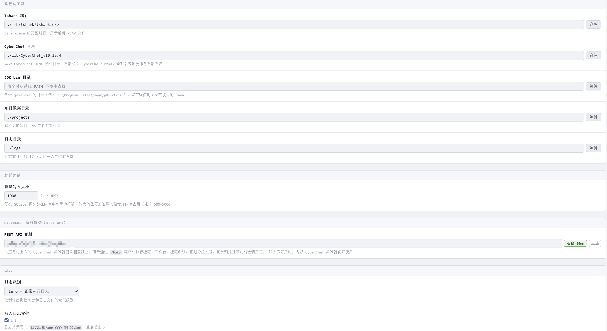
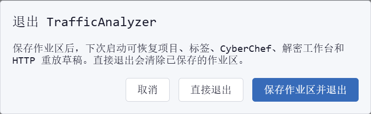
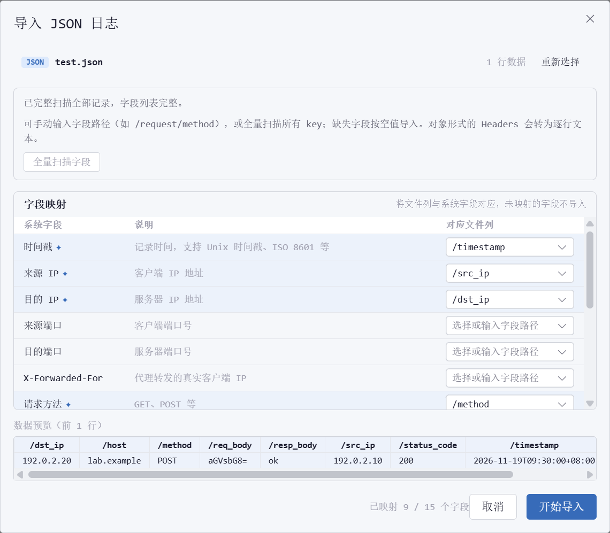
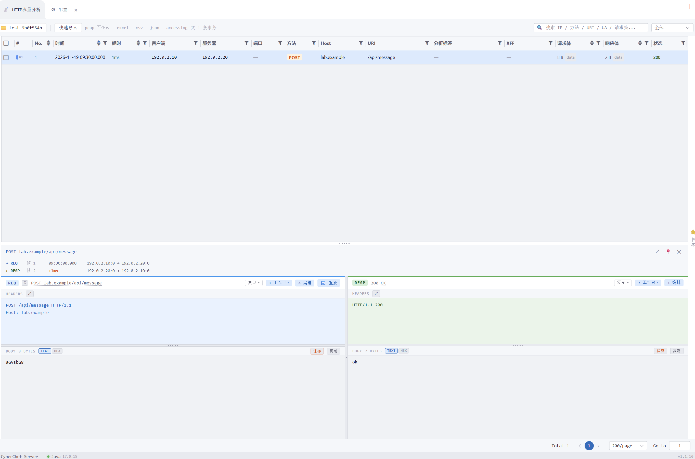
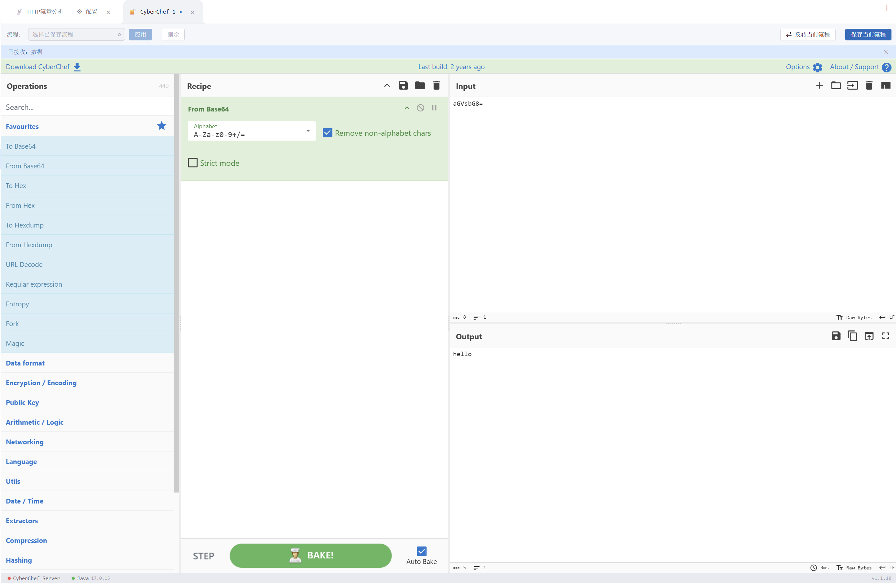
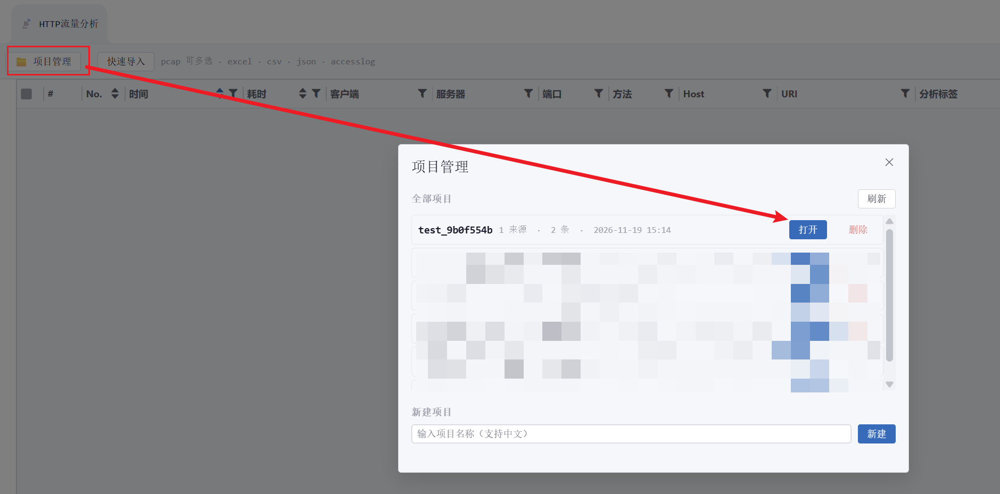

# 第一章 开始使用

本章介绍安装和首次配置，解释流量表中的 HTTP 事务，并带你从一条 JSON 日志完成导入、查看详情和发送数据。本文档基础版本适用版本为 v1.1.10 ，后续版本与本文档存在的差异性内容会及时调整和补充。

## 1.1 安装与首次配置

在 Windows 10/11 x64 上，从 [GitHub Releases](https://github.com/RynezzZ/TrafficAnalyzer/releases) 找到最新版本，下载 `TrafficAnalyzer-windows-amd64.zip`。将 ZIP 完整解压到当前用户可写的目录，再运行 `TrafficAnalyzer.exe`。保留程序旁的 `lib/` 和 `config/` 目录。界面无法启动或启动后空白时，先检查是否安装了 Microsoft Edge WebView2 Runtime。

使用1.1.9版本起的用户可从右下角版本号进入「关于 TrafficAnalyzer」检查更新。受支持的应用内升级会保留已有项目、配置、日志和用户提供的 GeoIP 数据库。预置流程文件仅在对应文件缺失时补入，因此升级不会覆盖已有流程库。

### 检查要用的组件

正常解压后即可使用发布包自带的组件。用 PCAP 开始分析时，先确认 tshark 路径。用本章的 JSON 日志熟悉使用时，只需要能打开程序。如要完成最后一步的解码，再确认内嵌 CyberChef 页面可用。

| 组件或配置项 | 接收什么 | 用途 |
| --- | --- | --- |
| **Tshark 路径** | `tshark.exe` 文件。发布包默认是 `./lib/tshark/tshark.exe` | 从 PCAP、PCAPNG 等抓包提取 HTTP 流量和网络层数据 |
| **CyberChef 目录** | 存放 `CyberChef*.html` 的文件夹。发布包默认是 `./lib/CyberChef_v10.19.4` | 打开应用内的 CyberChef 编辑器，交互式查看和处理数据 |
| **REST API 地址** | 运行中的 CyberChef Server 的基础 URL，默认 `http://localhost:3000`。填写服务地址即可，应用会调用其 `/bake` 接口 | 让工作台、正则分组处理、Java 工具的预处理等功能执行 CyberChef 配方 |
| **JDK bin 目录** | 含有 `java.exe` 的目录，例如 `C:\Program Files\Java\jdk-21\bin`。留空时通过系统 `PATH` 查找 Java | Java 反编译借助发布包中的 CFR 读取 `.class` 文件 |
| **项目数据目录** | 用于存放项目数据库的可写文件夹，默认 `./projects` | 新建项目，以及在「项目管理」中查找已有项目 |
| **OWASP CRS** | 发布包自带的规则目录，如 `./lib/coreruleset-4.24.1/rules` | 启用 CRS 规则时供威胁检测使用 |
| **GeoLite2 City** | 自行提供的 `.mmdb` 文件，默认读取 `./lib/geolite2city.mmdb` | 显示 IP 的地理位置信息，可按需补充 |

在左下角打开「配置」。路径输入框旁可用「浏览」选择文件或目录，修改后点击「保存配置」。CRS 和 GeoIP 默认从发布包配置指定的路径读取。GeoIP 文件放在默认位置即可使用。

点击底部状态栏中的 CyberChef 服务或 Java 状态可重新检测。如果检测CyberChef Server处于不可用状态，请检查 CyberChef Server 是否已单独启动、 URL 配置是否正确，特殊网络环境下可通过配置代理访问。



## 1.2 理解基本概念

### 项目、数据来源与原始文件

**项目**是一次分析使用的本地数据库。**数据来源**是导入项目的某一份文件，例如一个 PCAP 或一份 JSON 日志。同一项目可以容纳多个来源，来源列表可在「项目管理」中查看。

项目保存从原始文件提取的记录和分析结果。导入 PCAP 后，请尽量在原来的位置保留该抓包文件，后续的网络层分析、补充 HTTPS 密钥都可能需要重新读取它。Excel、CSV、JSON 和访问日志(accesslog)能提供的信息取决于原文件中的字段。日志只记录方法、路径和状态码时，仍然可以筛选请求和查看状态分布，但缺失的正文无法从日志恢复。

### HTTP 请求、响应与事务

客户端发出的消息叫**请求**（REQ），服务端返回的消息叫**响应**（RESP）。**HTTP 事务**代指流量表里的某一个HTTP请求的请求和响应整体。一条事务可以对应原始抓包里的多个帧，日志也可以用一行记录描述一个事务。

| 事务筛选项 | 表示什么 |
| --- | --- |
| **仅完整** | 有请求和配对响应。可分别查看两侧实际记录到的字段 |
| **无响应** | 有请求，当前数据中没有配对响应。抓包未覆盖响应、日志缺少响应字段等情况都可能出现 |
| **孤儿响应** | 有响应，当前数据中没有对应请求，如抓包从响应阶段才开始 |
| **WebSocket** | 查看识别出的 WebSocket 数据 |

**Headers** 是报文头部，描述内容类型、Cookie 等元数据。**Body** 是报文正文，可以是 JSON、普通文本或二进制文件等。请求还有方法和 URI，响应还有状态码。例如 `POST /api/message` 是请求方法和路径，`200` 是响应状态码。

可以根据需求选择发往不同的模块不同的内容，例如只想处理正文时，在详情的请求侧或响应侧选择「→ 工作台」→「发送 Body」；需要把两侧的字段和配对关系同时交给工作台和可视化编排时，可以选择「发送完整 HTTP 事务」。

### 文本、字节与编码

| 名称 | 怎么理解 |
| --- | --- |
| **TEXT** | 文本视图，便于阅读。对于二进制，预览里可能出现不可见字符的占位符 |
| **HEX** | 用十六进制表示每个字节。比如 `68 65 6c 6c 6f` 对应文本 `hello` 的字节 |
| **Base64** | 将字节表示为文本的一种编码，例如 `aGVsbG8=` 解码后得到 `hello` |

详情的 TEXT/HEX 切换只改变显示。「发送 Body」和 Body 区域的「保存」会保留实际字节。从界面选中文字再右键发送，传递的是选中的文本。把 `aGVsbG8=` 粘贴进普通文本输入框后，先按字符处理，执行 Base64 解码后才得到 `hello`。需要粘贴 Hex 字符串作为字节时，使用支持 Hex 输入的模式，或先用对应的解码操作转换。

### 配方、脚本、编排和工作台

| 名称 | 解决什么问题 |
| --- | --- |
| **CyberChef 配方（Recipe）** | 把 Base64 解码、解压等操作排成固定顺序，可保存后复用 |
| **Go 脚本** | 对内置操作难以表达的数据处理逻辑编写代码，并在运行时传入所需参数 |
| **可视化编排（Flow）** | 用节点和连线组合处理步骤，可按需要接收文本、字节或完整 HTTP 事务 |
| **外部 HTTP 服务** | 配置一个已有服务的 URL、请求参数和响应格式。运行时会把配置指定的输入发送到该地址，并将响应交给后续步骤 |
| **工作台处理流程（Pipeline）** | 把配方、脚本、Flow 等组织成按顺序执行的步骤，对队列中的输入逐条处理。请求和响应可分别配置 |
| **流程库** | 集中查找和管理已保存的资源，设置它可以在哪些模块被选用 |

全新安装可在「流程库」中找到 Base64、URL、Hex 等常用编解码配方(recipes)，以及 Go、正则和可视化编排示例。有现成配方时，可以先在 CyberChef 用单条输入验证，再将配方用于工作台。

### 项目保存与作业区恢复

项目保存已导入的数据和分析结果。各编辑器的「保存」会把配方、脚本、编排等保存为可复用资源。**作业区**记录上次工作进行到哪里，例如打开的项目、标签和当前页面，以及受支持的编辑内容。v1.1.10 可恢复 CyberChef 文本草稿、解密工作台队列和 HTTP 重放草稿及记录。

- 关闭程序时，可选择「保存作业区并退出」，下次由首个主窗口恢复。选择「直接退出」会清除已保存的作业区。
- 「配置」→「作业区」的「自动保存间隔」默认是每 3 分钟。可选择 1–5 分钟或关闭。意外退出时，以最近一次成功保存为准。
- 作业区在本机加密保存，绑定当前 Windows 用户。Go 脚本、可视化编排等编辑器中尚未保存的修改，退出前需要在各自页面单独保存。



## 1.3 完成第一次分析

### 选择导入文件

进入左侧「HTTP流量分析」，点击顶部「快速导入」。若出现「导入方式」，可以选择「新建独立项目」或「合并到当前项目」。在「项目管理」里对已经打开的项目点击「+ 导入」，会向该项目添加来源。

| 手上的文件 | 导入时要确认什么 |
| --- | --- |
| **抓包文件**（`.pcap`、`.pcapng`、`.cap`） | 会调用 tshark 解析，可同时选择多份抓包。提示「发现已有分析项目」时，选「使用已有数据」可继续已有分析。「重新导入」会重新解析并可能替换旧结果，有需保留的分析结果时优先复用 |
| **Excel / CSV**（`.xlsx`、`.csv`） | 一行对应一条 HTTP 记录。按预览把原表的列对应到系统字段，例如把 `client_ip` 映射到「来源 IP」。若手动选择格式时出现「CSV 分隔符」，选择文件实际使用的列分隔字符，例如逗号或制表符 |
| **JSON 日志**（`.json`、`.jsonl`、`.ndjson`） | 支持 UTF-8 的单个对象、对象数组和每行一个对象的 JSON。字段选择框可搜索或填写路径，例如 `/request/method` 对应 `request` 对象中的 `method`。预览未列出所需字段时，可手动输入路径或点击「全量扫描字段」 |
| **访问日志** | 在下拉框选择与文件相符的日志格式，例如 Nginx Combined。自定义「格式字符串」接收日志模板，如 `$remote_addr [$time_local] "$request" $status $body_bytes_sent`。根据解析预览核对字段与成功行数后再导入 |

导入表格或日志前，优先核对时间、来源 IP、方法、路径、状态码和两侧的 Body。时间戳可用 ISO 8601，例如 `2026-11-19T09:30:00+08:00`。路径字段可填 `/api/message`，完整 URL 则可以是 `http://lab.example/api/message`。状态码填 `200` 这样的数字。不存在的字段保持未映射即可。

### 如果抓包里有 HTTPS

**TLS** 是 HTTPS 用来保护传输的协议。v1.1.10 导入抓包后可能显示「TLS 待查看」，也可从「项目管理」点开对应 PCAP 来源的 TLS 状态，进入「HTTPS 解密」。SNI 是握手中可见的主机名线索，ALPN 用来识别协商的应用协议。协议版本和加密套件则帮助判断适用的密钥类型。

| 界面操作 | 选择什么文件 |
| --- | --- |
| **选择密钥日志（可多选）** | 与这份抓包中的连接对应的 TLS 会话密钥日志。TLS 1.3 和采用 ECDHE/DHE 的会话需要对应的会话密钥 |
| **选择 RSA 私钥（可多选）** | 仅在界面提示存在符合条件的旧式静态 RSA 握手时可用。选择与目标服务器匹配的未加密 PEM 格式 RSA 私钥 |

可以先查看已导入的流量，再为同一来源补充密钥。应用会从原始抓包添加新恢复的 HTTP 报文，保留之前已恢复的结果。覆盖统计按连接计数，同一连接可能包含多条报文。v1.1.10 的明文导入适用于可解析的 HTTP/1.x，暂不支持从 HTTP/2 或 HTTP/3 恢复 HTTP 记录。

### 导入一条日志并查看详情

1. 将下面一行保存为 UTF-8 的 `first-import.jsonl`。这是合成的日志记录，可以用其中的路径找到这条事务。

   ```json
   {"timestamp":"2026-11-19T09:30:00+08:00","src_ip":"192.0.2.10","dst_ip":"192.0.2.20","method":"POST","host":"lab.example","uri":"/api/message","status_code":200,"req_body":"aGVsbG8=","resp_body":"ok"}
   ```

2. 在「HTTP流量分析」点击「快速导入」，选择该文件。若正在打开其他项目，在「导入方式」中选择「新建独立项目」。当**导入的是非pcap等原始流量数据来源时，需要添加字段映射**，在「导入 JSON 日志」窗口核对自动识别的字段，尤其是以下几项。需要修正时，在右侧选择或输入对应路径，再点「开始导入」。

   | 系统字段 | 对应字段路径 |
   | --- | --- |
   | 请求方法 | `/method` |
   | URI 路径 | `/uri` |
   | 响应状态码 | `/status_code` |
   | 请求体 | `/req_body` |
   | 响应体 | `/resp_body` |

   

3. 在流量表右上角的搜索框输入 `/api/message`。搜索框可以填写 IP、方法、URI 等文本关键词。点击表格中的 `POST /api/message`，详情左侧 **REQ** 的 Body 应是 `aGVsbG8=`，右侧 **RESP** 的状态码应是 `200`，Body 应是 `ok`。正文显示为 HEX 时切回 TEXT。

   

4. 在请求 Body 中选中 `aGVsbG8=`，右键点击「发送至 CyberChef」。如果打开了多个 CyberChef 标签，选择要接收数据的标签。输入应出现在 CyberChef 的 **Input** 区。
5. 若顶部「流程」中已有「入门示例/Base64 解码（CyberChef）」，选择它并点击「应用」。也可在 **Operations** 中搜索 `From Base64`，拖入 **Recipe** 区。**Output** 应显示 `hello`。本次运行发生在内嵌 CyberChef 编辑器中。

   

导入的事务可通过「项目管理」再次打开。



在 CyberChef 看到的输出属于当前编辑器内容，如果希望下次直接调用当前调用的 Recipe，可点「保存当前流程」。关闭程序时如需保留编辑位置和受支持的草稿，选择「保存作业区并退出」。
