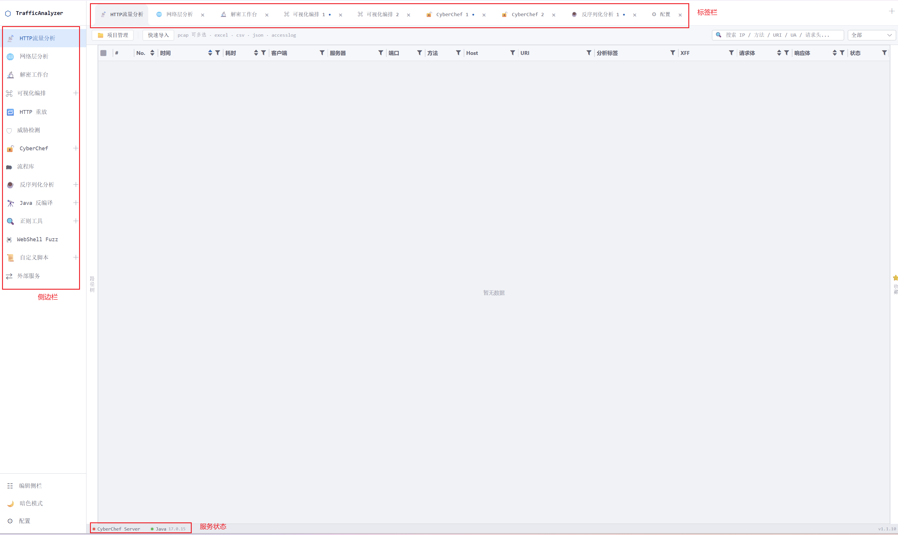
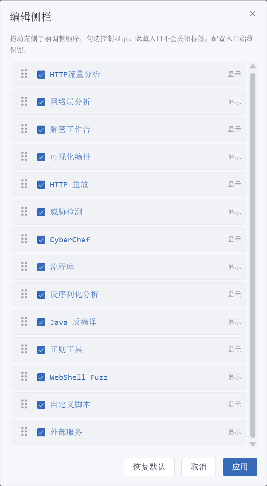
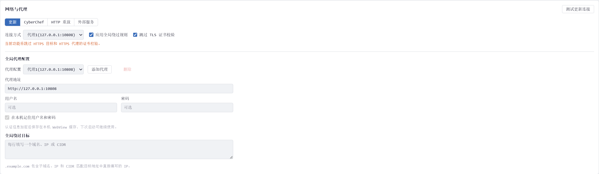
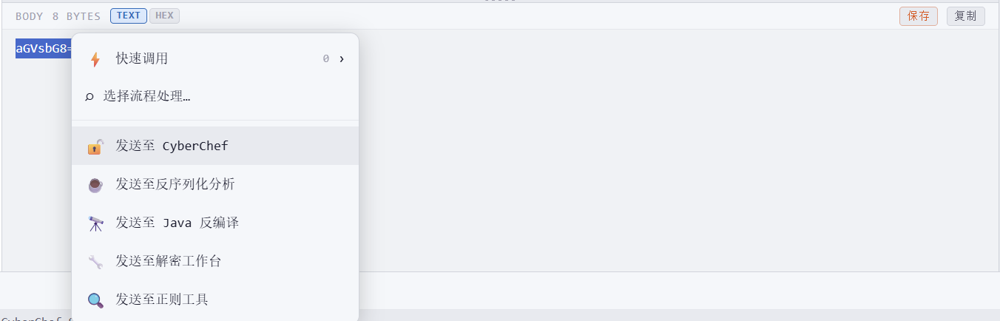
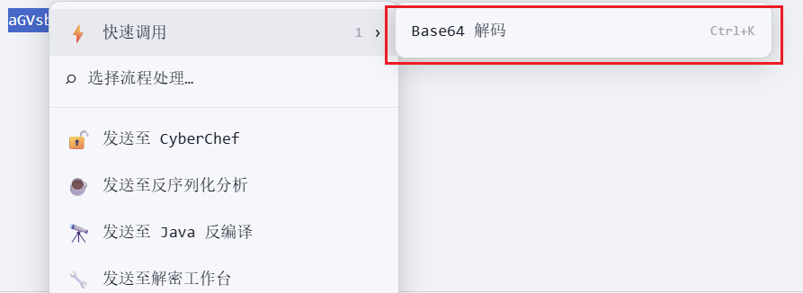
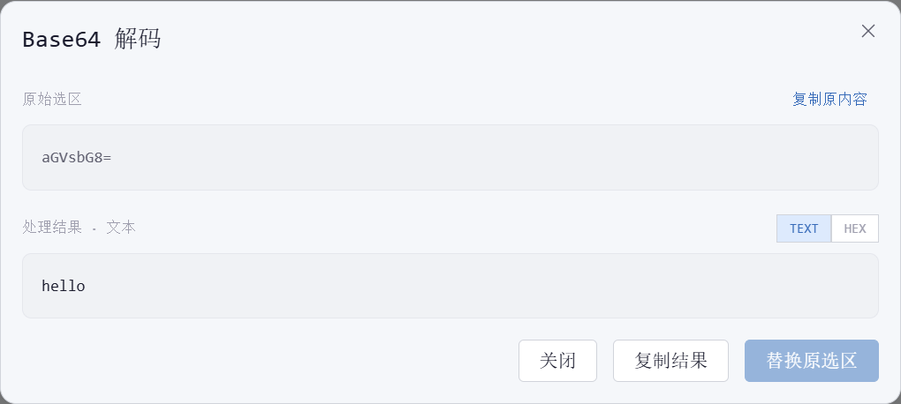

# 第二章 认识界面与菜单

适用版本：TrafficAnalyzer v1.1.10 +

本章介绍如何找到功能入口、管理标签页、修改配置，以及在不同页面间发送和处理数据。下载安装和初次导入见[第一章《开始使用》](./01-getting-started.md)。

## 2.1 主界面与标签页

| 界面区域 | 怎么用 |
| --- | --- |
| **左侧导航** | 点击模块名称打开页面。点击左上角的 TrafficAnalyzer 标志可折叠或展开侧栏 |
| **顶部标签栏** | 点击标签切换页面，左右拖动可调整顺序。标签较多时，可以横向滚动查看。支持多标签的工具可从右侧的「＋」新建 |
| **中间操作区** | 显示当前页面的工具栏、列表和编辑区。例如「HTTP流量分析」顶部有「项目管理」「快速导入」和搜索框 |
| **底部状态栏** | 查看 CyberChef Server 的连通状态和 Java 版本，点击相应项可重新检测。右下角版本号打开「关于 TrafficAnalyzer」 |
| **侧栏底部** | 「编辑侧栏」调整入口顺序和显示范围。「亮色模式」或「暗色模式」切换主题。「配置」管理组件路径、网络、日志和作业区 |

### 切换、新建与关闭标签

「HTTP流量分析」「解密工作台」「配置」等页面各有一个标签。点击侧栏会回到对应页面。点击这类标签的「×」会收起标签，之后可以从侧栏打开并继续当前操作。「HTTP流量分析」始终保留在标签栏。

CyberChef、可视化编排、反序列化分析、Java 反编译、正则工具和自定义脚本支持同时打开多个标签。各标签有独立的输入或编辑内容，适合在不同标签中分别准备样本。点击侧栏名称会回到该工具最近使用的标签。需要新建时，点击展开的侧栏中工具旁的「＋」，或从顶部「＋」菜单选择工具。CyberChef 最多打开 3 个，其余工具每类最多 5 个，多标签工具合计最多 20 个。

- **「●」** 表示标签含未保存修改或输入。关闭工具标签或向其中发送新数据时，可能出现「保留当前内容」提示。需要保留内容时，点「取消」，保存或复制后再操作。
- **「⟳」** 表示标签正在处理，等待处理结束后再关闭或发送新数据。
- 打开已在另一个标签中编辑的同一份源文档时，应用会切换到已有标签。需要保留两个版本时，可以将修改另存为独立资源。

### 调整侧栏

1. 点击左下角「编辑侧栏」，拖动条目左侧手柄排序。也可以选中手柄后用 `↑` 或 `↓` 移动条目。
2. 勾选要显示的模块，点击「应用」。应用会记住侧栏顺序和显示设置。隐藏入口后，已打开的标签仍可在顶部切换。「配置」入口始终保留。
3. 想恢复默认顺序和显示范围时，点击「恢复默认」，再点击「应用」。

## 2.2 菜单入口速查

| 想做什么 | 从哪里进入 |
| --- | --- |
| 导入抓包或日志，搜索并查看 HTTP 请求与响应 | **HTTP流量分析** |
| 从原始 PCAP 查看主机、拓扑、通信对和网络流 | **网络层分析** |
| 对请求、响应或手动输入的内容进行多步处理和批量执行 | **解密工作台** |
| 用节点和连线组合数据处理步骤，或在一个流程中读取 HTTP 事务的多个字段 | **可视化编排** |
| 查看、编辑捕获的 HTTP 请求，或核对测试服务返回的响应 | **HTTP 重放** |
| 查看规则命中、行为评分和可疑通信，再回查对应证据 | **威胁检测** |
| 交互式处理单条样本并保存配方（recipe） | **CyberChef** |
| 查找和管理已保存的资源，设置调用位置、快速调用和快捷键 | **流程库** |
| 检查 Java 序列化数据中的类、对象与字段 | **反序列化分析** |
| 阅读 Java `.class` 字节码的反编译结果 | **Java 反编译** |
| 验证匹配、捕获组和替换结果，或保存常用正则 | **正则工具** |
| 对捕获的 WebShell 通信样本进行离线分析，检查候选解密结果 | **WebShell Fuzz** |
| 编写、调试 Go 数据处理脚本和管理可复用函数 | **自定义脚本** |
| 配置已有 HTTP 服务的请求和响应格式，供编排或工作台调用 | **外部服务** |
| 修改路径、网络设置、自动保存间隔或日志选项 | **配置** |

如果侧栏缺少某个模块，先在「编辑侧栏」检查显示设置。多标签工具也可以从顶部「＋」菜单打开。

各页面的字段和操作步骤可从[第三部分 功能模块](./modules/index.md)直接查阅。

## 2.3 配置与服务状态

打开「配置」后，可用「浏览」选取文件或目录，也可直接填写路径。编辑后工具栏显示「未保存」，点击「保存配置」才会应用。要撤销本轮未保存的编辑，可点击「重新加载」读取已保存值。

| 配置区 | 字段或选项 | 接收内容和作用 |
| --- | --- | --- |
| 作业区 | **自动保存间隔** | 可选「关闭」或每 1–5 分钟，默认每 3 分钟。关闭自动保存后，仍可在退出时手动保存作业区 |
| 路径与工具 | **Tshark 路径** | 选择 `tshark.exe` 文件，用于解析抓包。发布包的默认路径是 `./lib/tshark/tshark.exe` |
| 路径与工具 | **CyberChef 目录** | 选择包含 `CyberChef*.html` 的文件夹。目录变更后内嵌编辑器的本地服务会重启，修改前可先保存当前配方 |
| 路径与工具 | **JDK bin 目录** | 选择含 `java.exe` 的目录。留空时在系统 `PATH` 中查找，供 Java 反编译使用 |
| 路径与工具 | **项目数据目录** | 选择用于存放和查找项目数据库的可写目录。改动目录时，已有项目文件需要自行迁移 |
| 路径与工具 | **日志目录** | 启用日志文件后使用的目录，默认 `./logs` |
| 解析参数 | **批量写入大小** | 填每批提交的记录条数，发布包默认 `1000`。较大的批次可能加快导入，也会占用更多内存 |
| CyberChef 执行服务（REST API） | **REST API 地址** | 填 CyberChef Server 的基础 URL，如 `http://localhost:3000`。工作台等模块会调用该地址下的 `/bake`，因此输入框填写到服务基础地址即可 |
| 日志 | **日志级别** | 选择记录的最低级别。Debug 包含详细信息，Info 记录日常运行，Warn 记录警告和错误，Error 仅记录错误 |
| 日志 | **写入日志文件** | 控制是否在日志目录生成按天保存的 `app-YYYY-MM-DD.log`。需要改变日志写入位置时，可保存配置后重启并检查新目录 |

配置页中的 **CyberChef 目录**用于打开编辑器，**REST API 地址**用于调用独立的执行服务。查看地址旁的状态及路由标签，或者点底部「CyberChef Server」重新检测。编辑器能打开但执行服务不可用时，检查服务进程、地址和网络路由。Java 未检测到时，核对 `java.exe` 所在目录，再点底部「Java」复测。

### 设置网络与代理

「网络与代理」页签对应不同请求来源。「更新」用于应用内检查与下载版本，「CyberChef」用于执行服务，「HTTP 重放」用于重放请求，「外部服务」用于调用已配置的 HTTP 服务。各页签可单独选择「直连」或一个代理配置。

1. 如果需要代理，点「添加代理」。在「代理地址」填协议、主机和端口，例如 `http://127.0.0.1:7890`。支持 `http`、`https` 和 `socks5`。需要认证时，在「用户名」「密码」中分别填写代理服务提供的凭据。
2. 勾选「在本机记住用户名和密码」后，认证信息会加密保存到当前 Windows 用户的 WebView 缓存。取消勾选时，凭据仅供本次运行使用。要删除已经设置的凭据，点击「清除认证」后保存。
3. 如果有目标需要直连，在「全局绕过目标」中每行填一条规则。可用域名（如 `localhost`）、带前导点的域名（如 `.example.com`，包含子域名）、IP（如 `127.0.0.1`）或网段（如 `192.0.2.0/24`）。IP 和网段匹配目标地址中直接填写的 IP。为相应功能勾选「应用全局绕过规则」，匹配的请求会走直连。
4. 切换到要配置的功能页签，在「连接方式」中选择刚设置的代理或「直连」。点击「保存配置」，新设置用于之后发起的请求。删除仍在使用的代理前，先将引用它的功能改为其他连接方式。
5. 点「测试更新连接」验证应用能否按「更新」页签的设置访问发布服务。CyberChef 则点击底部服务状态检测。若路由标签显示「直连 · 绕过规则」，表示该目标符合绕过规则。

「跳过 TLS 证书校验」控制是否验证 HTTPS 连接对端的证书，默认保持校验开启，特定代理方式导致无法通过证书校验，因此需要关闭该选项才可以正常连接。「HTTP 重放」页签中的开关控制 HTTPS **代理**的证书校验，重放请求的**目标**证书由重放页面的单次选项控制。

## 2.4 通用操作

### 从右键菜单发送数据

在详情正文或普通输入框里拖动选中文本，点击右键。选择「发送至 CyberChef」「发送至正则工具」等，会把选区文本填入目标模块。要处理原始 Body 或保留请求与响应的配对关系，可使用 HTTP 详情里的发送按钮，见[第一章的 HTTP 事务说明](./01-getting-started.md#http-请求、响应与事务)。

发送到支持多标签的工具时，尚未打开该工具会自动新建一个标签。只打开了一个空闲标签时通常直接送达，有多个标签或唯一的标签正在处理时会弹出选择框。部分操作也会主动询问接收位置，例如在工作台中把当前流程打开到 CyberChef。选中已有标签或「新建」选项，再点「发送」。出现替换提示时，可取消并保留目标标签中的内容，或重新发送到新标签。

流量表部分单元格还有单独的悬停菜单。「筛选」只保留匹配该值的记录，「排除」剔除匹配项，「复制」将单元格值放进剪贴板。菜单中的按钮取决于该列支持的操作。

### 对选中文本执行流程

| 右键入口 | 使用方式 |
| --- | --- |
| **选择流程处理…** | 打开完整的流程选择器。搜索框接收流程名称、标签或说明，也可按类型、分组、收藏和最近使用筛选。选中候选后按 `Enter` 或点击「执行流程」 |
| **快速调用** | 直接列出已设置为快速调用的流程。选中一项，会立即处理当前选区 |
| **发送至…** | 将文本交给另一个工具，便于检查输入或继续编辑 |

例如，在第一章样例的请求 Body 中选中 `aGVsbG8=`，右键点击「选择流程处理…」，选「内置编解码」中的「Base64 解码」并执行。

使用默认的「展示结果」时，弹窗会同时显示原始选区和结果 `hello`。此处的内置 Base64 解码可在本地完成。

要把常用流程加入短菜单，在「流程库」点选该流程，在「调用设置」的「在哪里调用」中勾选「快速调用」，再点「保存设置」。勾选时会一并启用「右键菜单」，只勾选「右键菜单」时，可以通过「选择流程处理…」找到该流程。收藏主要用于筛选常用流程，快捷子菜单取决于「快速调用」设置和输入是否适用。

### 设置快捷键和结果动作

1. 在「流程库」选中流程，勾选「右键菜单」。
2. 点击「选中文本快捷调用」下的录入框，直接按要绑定的组合键。应用会检查组合键是否被保留或与其他流程冲突。点「清除」可解除绑定。
3. 在「调用后如何处理」选择结果动作并点击「保存设置」。回到支持选区操作的页面，选中文本后按组合键即可调用。

| 结果动作 | 执行后会发生什么 |
| --- | --- |
| **展示结果** | 打开结果弹窗，对照原始选区与输出，可切换 TEXT/HEX 或点击「复制结果」 |
| **复制结果** | 将结果复制到剪贴板。二进制结果以 HEX 文本复制 |
| **替换选区（可编辑区域）** | 将文本结果写回原选区，可用 `Ctrl+Z` 撤销。只读区域、二进制结果或已变化的选区会保留为预览 |

快捷键在 TrafficAnalyzer 的主界面有文本选区时生效，内嵌 CyberChef 编辑器中的文本选区暂不支持这类快捷键。快速处理使用已保存的参数默认值。若流程需要完整 HTTP 事务，请从详情发送事务，再在工作台或可视化编排中调用。

### 检查版本与更新

1. 点击右下角版本号，打开「关于 TrafficAnalyzer」，查看当前版本和发布仓库。点击「检查更新」后，应用才会向 GitHub 查询版本。
2. 有兼容的更新包时，点击「下载更新」，等下载和验证结束后点「重启安装」。出现退出对话框时，可以选择保存作业区。编排和脚本中尚未保存的修改要先在各自页面保存。
3. 需要手动获取更新包时，点击「前往下载」，从打开的发布页选择对应附件。检查失败时，可先在「配置」→「网络与代理」测试更新连接。
