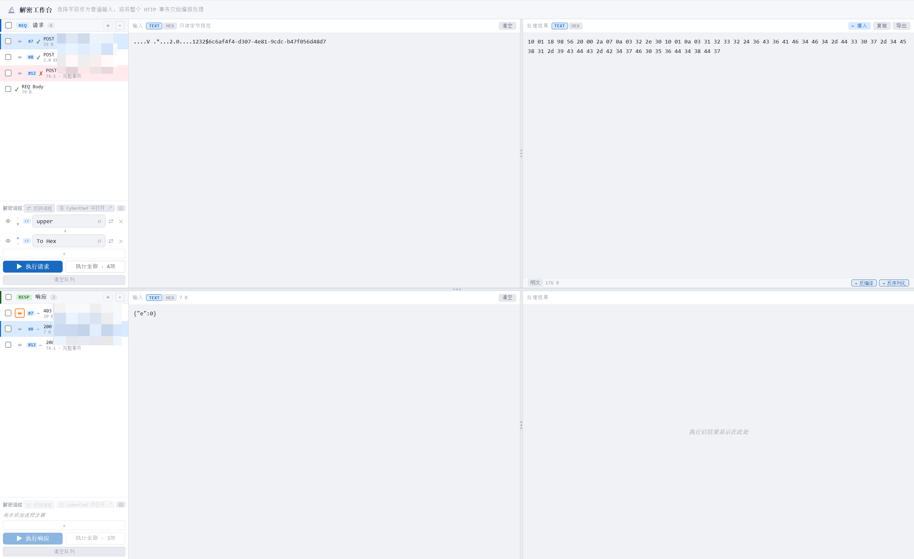
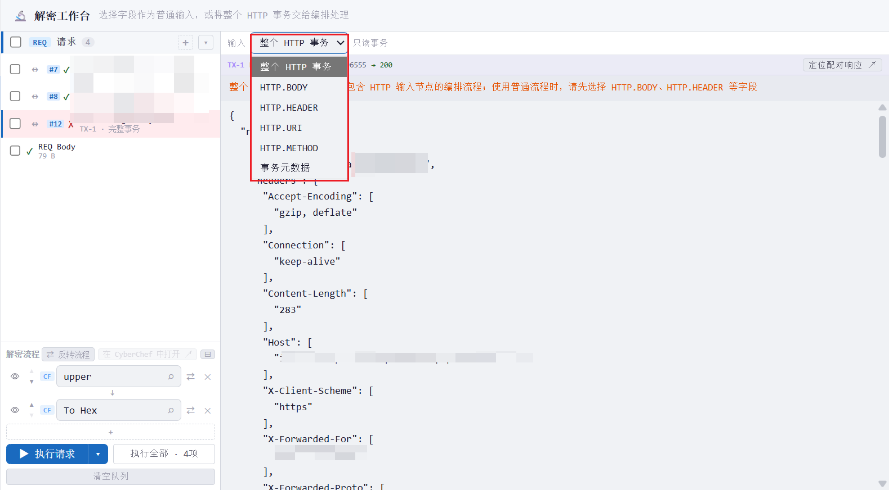
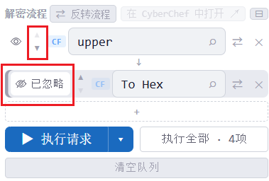
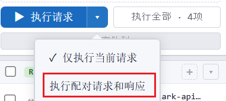

# 第四章 解密工作台

适用版本：TrafficAnalyzer v1.1.10

「解密工作台」用一组处理步骤检查一条或多条输入。可以先解码单段文本，再用同一侧的流程处理多条正文。也可以把请求和响应作为同一个 HTTP 事务送进队列，分别执行两侧的处理步骤。

## 4.1 认识工作台

工作台分为上方 **REQ 请求** 和下方 **RESP 响应**。两侧各有一套「解密流程」。同侧的队列项共用这套流程，每条输入各自保留编辑内容、运行状态和结果。

| 区域 | 怎么用 |
| --- | --- |
| **队列** | 点一行查看该条输入与结果。勾选行用来指定批量范围。「＋」新建手动输入，「×」移除一项，「清空队列」移除当前侧的项目 |
| **解密流程** | 点流程下方的「＋」添加步骤，按顺序组成处理链。可收起为摘要，点击摘要重新展开 |
| **输入** | 粘贴或修改当前内容。选中事务后，还可选择本侧的输入来源 |
| **处理结果** | 查看当前选中项的输出、错误或跳过原因，按需复制、回填、导出或发送到其他工具 |

空队列所在的半区可能折叠，点击半区标题展开。两侧都展开时可拖动中间分隔条调整上下高度，输入和处理结果之间也可以拖动调整宽度。

## 4.2 添加数据并选择输入

### 从哪里添加

| 要处理的内容 | 操作入口 | 入队后的数据 |
| --- | --- | --- |
| **手动输入** | 点击请求或响应队列标题旁的「＋」，在「输入」中粘贴或填写 | 当前侧的独立输入。可选 TEXT 或 HEX |
| **单段正文或头部** | 从[HTTP 流量详情](./modules/http-traffic.md)对应侧点击「→ 工作台」→「发送 Body」「发送 Headers」或「发送全部」 | 当前侧的正文字节、头部文本，或该侧的头部与正文。每次发送都是一条独立输入 |
| **多条记录的正文** | 在 HTTP 列表勾选记录，点击「→ 工作台」主按钮，或在下拉菜单选择「发送请求/响应 Body」 | 每条记录已有的正文分别到请求侧或响应侧，空正文不生成独立任务 |
| **HTTP 事务** | 在详情中点「发送完整 HTTP 事务」，或勾选表格行后选择「作为完整 HTTP 事务发送」 | 保留已有的请求、响应、头部、正文及事务信息，队列中用同一 `TX-…` 编号表示配对关系 |
| **选中的文字** | 在主窗口拖选文字，右键「发送至解密工作台」 | 选区文字作为普通输入进入请求侧。需要从响应侧处理原始 Body 时，用详情中响应侧的发送按钮 |

### 选择事务字段

点选带事务编号的记录，可在「输入」标题旁选择下列来源。请求侧和响应侧各有自己的来源设置，同侧队列中的事务会一起切换。普通输入保持原样。

| 输入来源 | 会交给流程的数据 |
| --- | --- |
| **整个 HTTP 事务** | 请求、响应和事务元数据作为一个只读对象。第一个实际参与执行的步骤须是含「HTTP 事务」输入节点的可视化编排 |
| **HTTP.BODY** | 当前侧的原始正文。适合解码、解压或交给接收字节的节点 |
| **HTTP.HEADER** | 当前侧的头部文本，重复出现的头分别保留 |
| **HTTP.URI／HTTP.METHOD** | 请求侧的 URI 或方法，如 `/api/message` 或 `POST` |
| **HTTP.STATUS** | 响应侧的状态码文本，如 `200` |
| **事务元数据** | 以 JSON 文本显示事务关联信息，例如包 ID |

工作台初始来源是「整个 HTTP 事务」。普通配方(recipe)只要处理正文时，先选「HTTP.BODY」。选择具体字段后，可以编辑该字段的输入，执行时使用编辑后的值。需要读取请求和响应多个字段的 Flow 时，用「整个 HTTP 事务」传入原始对象。

### TEXT、HEX 和右键操作

- **TEXT** 接收文字。粘贴 `aGVsbG8=` 时，它以字符串进入步骤，由相应配方解码。二进制数据在 TEXT 中可能用点号预览，显示为「只读字节预览」时，执行仍使用原始字节。
- **HEX** 用十六进制写实际字节。例如输入 `68 65 6c 6c 6f` 表示 `hello` 的 5 个字节。字节需要写完整。如果编辑中的 HEX 有缺位或非法字符，先修正输入再切换模式或执行。
- **右键**。可在输入框选中文本后点「快速调用」或「选择流程处理…」，对选区单独处理。选择替换结果时会修改输入草稿。要让一组步骤处理整个输入或多条数据，使用工作台的执行按钮。选区快捷键见[第二章](./02-interface-and-menus.md)。

## 4.3 搭建并调整处理流程

在要处理的那一侧点「解密流程」下方的「＋」，在「添加流程步骤」里按类型或名称找资源。请求侧和响应侧的候选受各自的调用位置限制。找不到已保存资源时，可到[流程库](./modules/workflow-library.md)核对「工作台 · 请求」或「工作台 · 响应」是否勾选。

| 步骤类型 | 输入与配置 |
| --- | --- |
| **CyberChef 配方** | 选择保存好的 Recipe，由 CyberChef Server 执行。带模板参数的配方会显示可填写的参数，例如密钥或 IV。按字段提示填写已知值，覆盖只用于当前步骤 |
| **Go 脚本** | 选择保存好的脚本。若显示「GO 参数」，可填写字符串覆盖值，支持多行。按脚本函数签名接收和返回文本或字节 |
| **可视化编排** | 选择已指定结果端口的 Flow。按下文绑定输入，后续步骤会收到该 Flow 的结果 |
| **正则替换** | 在「手动」模式填表达式、Flags 和替换文字，例如替换式中的 `$1` 表示第一组。也可切到「已保存」载入正则配置 |
| **分组匹配解密** | 填正则、Flags、捕获组编号并选择处理配方。组 `0` 表示整个匹配，`1` 表示第一组。每个命中的片段分别处理并回填原文。需要 CyberChef Server |
| **Java 反序列化／Java 反编译** | 接收上一步输出的原始序列化流或 Class 字节，输出可读文本。若拿到 Base64 或 Hex 文本，先加解码步骤。反编译需要 Java |
| **外部服务** | 选择在[外部服务](./modules/external-services.md)页保存的接口。核对步骤显示的方法与地址。执行时将此步骤的输入发送到对应服务，响应按配置作为正文或 JSON 返回 |

首个普通步骤读取当前输入，后续步骤读取上一步的实际输出。正则替换与分组处理需要文本。如果数据还是不可读的二进制，先用适当的转换步骤。正则 Flags 中 `g` 用于处理多处匹配，去掉 `g` 时只检查首处。已保存的正则也可以用作内联步骤的素材。

### 给 Flow 绑定输入

- **字段或普通输入**。在 Flow 步骤的「输入数据 →」选择一个具名输入，将当前字段或上一步输出绑定到该端口。也可选择「不使用输入数据」，只用下方手动参数和画布里的常量。其余具名输入可在下方填写文本。
- **整个 HTTP 事务**。让含「HTTP 事务」节点的 Flow 成为第一步。事务由这个节点读取，可同时访问已有的请求和响应。额外具名参数仍可在步骤下方填写。Flow 输出可以接着交给普通配方、脚本或其他步骤。

在编排页面先选择「结果端口（工作台必选）」再保存。需要完整事务的 Flow 不能从单个字段取得事务上下文。相关节点、端口和调试入口见[可视化编排](./modules/flow-editor.md)。

### 排序、忽略和反转

- **上移／下移**。点击 ▲／▼ 改变顺序。点击步骤末尾的「×」移除步骤。
- **临时忽略**。点击步骤左侧眼睛图标，出现「已忽略」时，执行跳过这一步，参数与位置保留。再次点击可启用。要单独检查某一步，可临时忽略其余步骤，并确保当前输入符合这一步的类型。
- **反转**。配方行的「⇄」临时反转这一步。标题栏「反转流程」要求本侧已启用的步骤均为可反转的 CyberChef 配方，会反转其算子并倒转已启用步骤的顺序。已忽略的步骤留在原位。当前工作台的反转状态可以随作业区恢复，源配方仍通过 CyberChef 的保存入口管理。

## 4.4 执行单条或同批输入

先点中一条有代表性的输入，核对它的来源和类型，再运行一次。可以用手动输入 `aGVsbG8=` 与保存的 CyberChef Base64 解码配方检查执行是否正常，预期显示 `hello`。如果配方可在编辑器里运行、工作台提示连接失败，请检查底部「CyberChef Server」。

### 选执行范围

| 当前输入与范围 | 点击执行按钮 | 点击旁边的批量按钮 |
| --- | --- | --- |
| **普通输入** | 「执行请求」或「执行响应」处理本侧当前项 | 处理本侧的「执行所选」或「执行全部」 |
| **HTTP 事务 → 仅执行当前请求／响应** | 使用当前侧的输入和流程，处理选中事务的一侧 | 只处理当前侧队列中的所选项或全部项 |
| **HTTP 事务 → 执行配对请求和响应** | 「执行事务」分别使用两侧各自的输入和流程 | 只处理 HTTP 事务。按事务计数，同一事务的两侧勾选会合并计算 |

选中事务后，通过执行按钮旁的下拉箭头选择范围。当同时传入了一个请求的请求和响应时，可以切换选择“执行配对请求和响应”，实现请求和响应同时执行相应的recipe，一侧失败时，另一侧可以继续。缺少对应侧时会提示，未配置流程或所有步骤已忽略的一侧会跳过，并保留该侧已有结果。

### 观察进度与停止

开始执行时，工作台会固定该批次的输入、步骤、参数和可执行资源。此后保存的资源修改用于下一次执行。工具栏显示已处理数及成功、失败计数。点击「停止」后，当前处理项完成再停止后续项。已完成结果保留。

运行期间不能再启动一批任务，队列移除和事务来源切换暂停。输入被编辑后，旧输出旁会出现「上次执行结果」。再次执行会按当前输入重新计算。

## 4.5 查看、回填或导出结果

选中队列里的某条记录，查看它在右侧的「处理结果」。成功时可以切换 TEXT／HEX。底部会显示明文或二进制提示、大小和可识别的文件类型。有图片类型时可点「渲染图片」预览。

| 操作 | 会得到什么 |
| --- | --- |
| **← 填入** | 将结果按实际文本或字节类型填回当前输入，随后结果区清空，便于换一组步骤继续处理。可对普通输入或选中的事务字段使用 |
| **复制** | 复制当前显示内容。需要复制十六进制时，先切换 HEX |
| **导出** | TEXT 下，文本保存为 `.txt`，二进制结果保存为原始字节 `.bin`。HEX 下保存十六进制文本 `.hex`。需要完整二进制文件时，使用 TEXT 下的导出 |
| **→ 反编译／→ 反序列化** | 有可用字节结果时，将其无损送到对应 Java 工具。Class 通常以 `CA FE BA BE` 开头，标准序列化流通常以 `AC ED 00 05` 开头 |

想处理结果中的一小段文字，可以选中后右键调用流程或发送到 [CyberChef](./modules/cyberchef.md)。要继续使用完整字节，可用「填入」、二进制导出或对应的字节发送按钮。

## 4.6 定位问题并保存工作进度

### 找出哪一步失败

1. 在队列中点失败项。结果区显示错误，解密流程会标出该输入停在哪一步。连续 CyberChef 配方合并执行时，可能标出一组步骤。Flow 报错时，可按提示里的节点和端口回到编排中检查。
2. 先核对输入来源和类型，再确认失败步骤的名称、参数和所需服务。选「整个 HTTP 事务」但第一步是普通配方时，切换到「HTTP.BODY」或其他字段，或换成读取事务的 Flow。
3. 若当前启用的步骤全是 CyberChef 配方，且选中的输入是普通内容或事务字段，可点「在 CyberChef 中打开」。这会带上当前输入、参数覆盖和临时反转后的操作，跳过忽略的步骤。已有 CyberChef 标签时可选接收位置。可在编辑器逐段核对算子，再用当前配方保存入口保留需要复用的版本。
4. 改动输入或流程后重跑该条数据。失败标记对应当次执行的输入和步骤，用新结果确认修正是否生效。

### 常见问题

- **执行按钮不可用。** 先选中队列项，再检查当前范围内是否有已配置、已启用的步骤。名称空白或缺必填配置的步骤不能用于执行。
- **找不到配方、脚本或 Flow。** 检查[流程库](./modules/workflow-library.md)里的调用位置。Flow 还要满足当前输入类型，并设置结果端口。
- **两侧都有内容，无法配对执行。** 检查是否为同一个 `TX-…` 事务。分别发送的 Body 和 Headers 是独立输入。需要同时处理时，从 HTTP 流量分析重新发送完整事务。
- **返回乱码或 Java 解析失败。** 检查实际输出字节和类型。TEXT 预览可能以点号显示不可读字节，HEX 视图可核对文件头。Base64、Hex 等字符需要先按相应方式转换成字节。

### 保存工作台状态

退出时选「保存作业区并退出」，可保留当前队列、两侧处理步骤、输入来源、执行范围和已保存进作业区的结果。配置自动保存后，意外退出时可恢复到最近一次成功保存的状态。正在执行或调试时，等操作结束后再保存。希望跨项目复用的步骤，可在各编辑器保存配方、脚本或编排，并在流程库设置调用位置。
