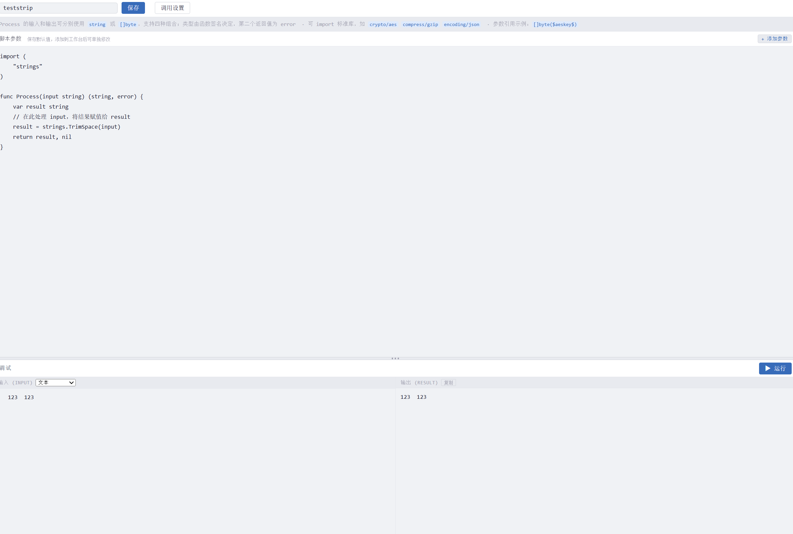
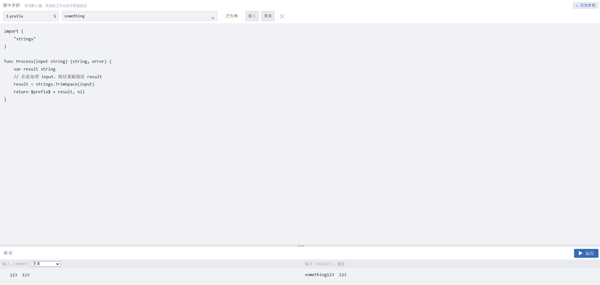
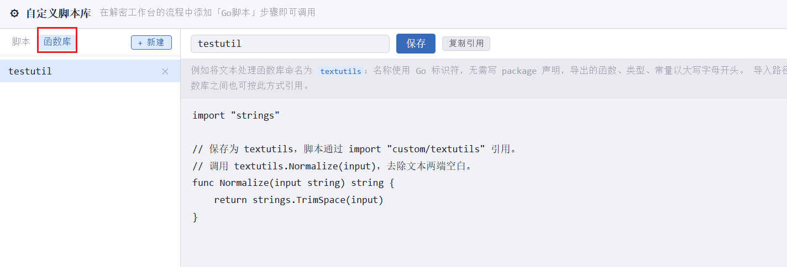

# 3.12 自定义脚本

适用版本：TrafficAnalyzer v1.1.10 +

「自定义脚本」适合把固定的数据转换逻辑写成 Go 代码，保存后在工作台、可视化编排或快速调用中复用。可先在此页面用一条输入调试。

## 新建和调试脚本

1. 打开「自定义脚本」，选择「脚本」→「+ 新建」。填写唯一的脚本名称，在代码区编写 `Process` 函数。可以引用支持的 Go 标准库，`package` 声明由应用补齐。
2. 在底部「调试」填写测试输入，选择「文本」「Hex 字节」或「Base64 字节」，点击「运行」。右侧显示结果或错误。二进制结果可切换自动、Hex、Base64 或 UTF-8 预览。
3. 点「保存」，在保存窗口设置调用位置。编辑已有脚本时，可修改名称并使用「另存为新名称」保留原脚本。

入口函数的入参和首个返回值可独立使用 `string` 或 `[]byte`，第二个返回值为 `error`。选择签名时，先决定下一步需要文本还是字节。例如下面的脚本只去掉文本首尾空白，测试输入 `  hello  ` 时输出 `hello`。

```go
import "strings"

func Process(input string) (string, error) {
    return strings.TrimSpace(input), nil
}
```

预览格式只改变显示方式。需要传递二进制时，用 `[]byte` 表达真实输入或输出。返回文本应是有效 UTF-8。



## 配置可覆盖的参数

在「脚本参数」点「+ 添加参数」。参数名填简短的标识名，例如 `prefix`，默认值填字符串。代码中直接使用 `$prefix$`，如 `return $prefix$ + input, nil`。应用会生成 Go 字符串，因此占位符外无需再加引号。



参数默认值支持多行。点参数行的展开按钮即可编辑，收起不会改变换行。「插入」将占位符放到编辑器中记录的光标位置，「复制」把占位符放进剪贴板。工作台可以为某个步骤覆盖默认值，快速调用使用保存的默认值。

## 把公共逻辑保存为函数库

1. 在左上切换到「函数库」，点击「+ 新建」。填写 Go 标识符作为名称，例如 `textutils`。在代码区定义供其他脚本使用的函数，如 `Normalize`。导出的函数、类型和常量用大写字母开头。
2. 点击「保存」。可用「复制引用」取得导入路径。脚本中写 `import "custom/textutils"`，再调用 `textutils.Normalize(input)`。`custom/` 是固定前缀。
3. 在引用它的脚本中运行测试。函数库通过普通函数参数传值，作为脚本依赖使用。库的保存修改会在下次执行时生效。已有引用的库需要先解除引用才能删除。



## 从其他模块调用

在解密工作台添加 Go 脚本步骤，可在调用的步骤调整参数值。

可视化编排用「自定义 Go 脚本」节点连接输入和结果。要在选区上快速执行，在「调用设置」启用相应位置，然后到主窗口选中文本，通过右键「快速调用」或「选择流程处理…」执行。

脚本和依赖可通过[流程库](./workflow-library.md)导出。导入会保存代码，运行前可先打开编辑器查看实现。要在编排里接收二进制结果，核对该脚本的返回值类型。
