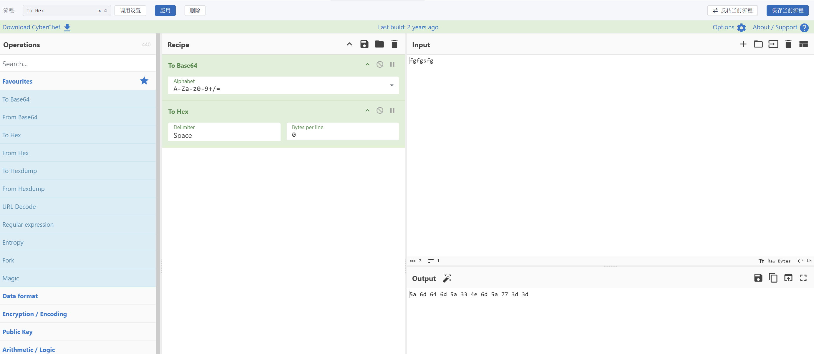

# 3.6 CyberChef

适用版本：TrafficAnalyzer v1.1.10

CyberChef 适合用单条样本验证编码转换、解压或字段处理。调试通过后可把 Recipe 保存到流程库，供工作台或其他模块复用。

## 输入数据并搭建配方

| 区域 | 怎么用 |
| --- | --- |
| **Input** | 放要处理的样本。输入 Base64、Hex 等字符串后，需要在 Recipe 中选择相应解码操作 |
| **Operations** | 按名称搜索算子，如 `From Base64`，拖入 Recipe |
| **Recipe** | 按从上到下的顺序执行算子。可拖动重排，并在各算子卡片修改参数 |
| **Output** | 查看处理后的数据。遇到不可读内容时，可根据预期类型加相应的显示或转换操作 |

可在 Input 粘贴 `aGVsbG8=`，添加 `From Base64`，检查 Output 是否是 `hello`。复杂配方可以先验证前几步，再逐步追加。

从 HTTP 详情、正则工具的文本区域等位置，可以选中文本后右键「发送至 CyberChef」。HTTP 重放的响应区也有「→CyberChef」标识。如果应用询问接收位置，选一个已有标签或新建标签。内嵌编辑器使用其自身的操作界面，TrafficAnalyzer 的选区快捷键主要用于主窗口其他文本区域。

## 加载、保存与反转

1. 在顶部「流程」选择已保存的配方，再点击「应用」。应用会尝试保留当前 Input，可用同一份样本核对所选流程的输出。
2. 在该页面调试完毕后点「保存当前流程」。填写流程名称，可指定分组与调用位置。如果提示粘贴 CyberChef 页面地址，填包含 `#recipe=` 的完整 URL。保存的资源可在[流程库](./workflow-library.md)中管理。
3. 想尝试逆向转换时，点击「反转当前流程」。反转针对编辑器中**当前**的算子序列，保留输入。不可逆操作会给出错误提示。对可逆配方，用对应方向的输入重新验证，再点「保存当前流程」保存当前配方，或另起名称保留两份。

## 在其他模块调用

配方的调用位置决定它在哪些选择器里出现。可在编辑器顶部点「调用设置」，或者到流程库调整。

- **工作台**。添加保存好的配方作为一步，批量执行时使用当前步骤接到的文本或字节。全 CyberChef 步骤可从工作台打开到 CyberChef，检查当前参数、步骤顺序和输入。
- **可视化编排**。可添加「CyberChef Recipe」节点使用保存好的配方，或添加「CyberChef Operation」配置一个算子。
- **其他选择器**。正则分组、Java 预处理、重放发送前处理和右键快捷调用各自按调用位置列出可用配方。

**配置排查。** 内嵌页面无法加载时检查「CyberChef 目录」。编辑器能运行而工作台等模块报连接错误时，检查底部「CyberChef Server」和 REST API 地址。内嵌编辑器与程序化执行服务分别配置，具体见[第二章](../02-interface-and-menus.md)。
