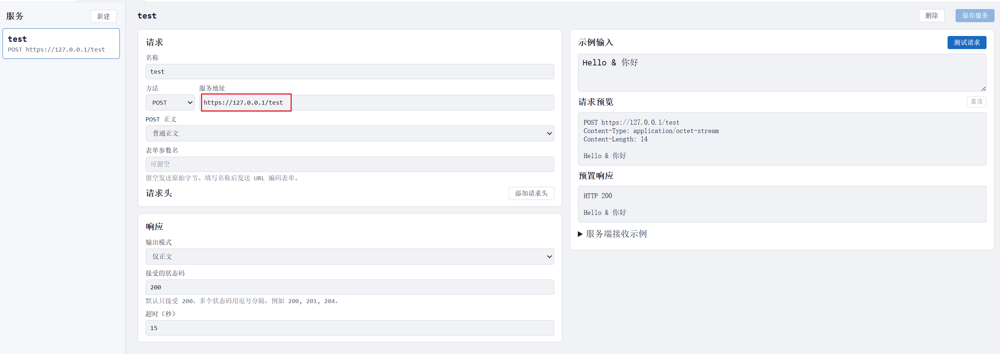

# 3.13 外部服务

适用版本：TrafficAnalyzer v1.1.10

「外部服务」把已有 HTTP 内容处理服务配置成可以复用的步骤。可以先用示例输入核对请求和响应，再把它交给解密工作台或可视化编排。输入会发送到配置的服务地址，适合已确认接收范围的内容转换接口，例如内部格式解析服务。

## 配置请求

进入「外部服务」，点「新建」，填写服务名称和接收请求的完整 HTTP／HTTPS 地址。名称用于在工作台或编排中选择服务，地址需要写到具体接口路径。

| 请求方式 | 参数怎么填 | 应用怎样发送输入 |
| --- | --- | --- |
| **GET** | 填「查询参数名」，如 `q` | 将输入编码后作为 URL 查询参数值 |
| **POST → 普通正文** | 「表单参数名」可留空 | 留空时以正文发送原始字节。填入名称时，以 URL 编码的表单发送该参数 |
| **POST → JSON 对象** | 填「JSON 字段名」，如 `text` | 将输入作为该字段的字符串值，例如输入 `hello` 会生成 `{"text":"hello"}` |

有参数值时可选「UTF-8 文本」或「Base64」。接口约定接收的是 UTF-8 字符串时选文本，约定用 Base64 承载字节时选 Base64。GET 和表单参数仍会按各自的位置处理 URL 编码。

需要添加认证或内容类型时，点击「添加请求头」，分别填写头名和值。可勾选「保密保存」将值加密保存到本机，Authorization 和 Cookie 自动作为保密头处理。修改服务地址后要重新填写保密值。

## 配置输出并测试

| 字段 | 填什么或如何使用 |
| --- | --- |
| **仅正文** | 后续节点收到原始正文字节。「接受的状态码」默认只包含 `200`，可输入多个逗号分隔的状态码 |
| **封装响应** | 输出包含 `bodyBase64`、`status` 和 `headers` 的 JSON。非 2xx 响应也可以供下游判断。需要正文时再取 `bodyBase64` 解码 |
| **超时（秒）** | 填 1–60 之间的秒数，按服务响应时间选择 |

## 在工作台和编排中复用

- **解密工作台**。在请求侧或响应侧添加步骤，选择「外部服务」及已保存服务。核对步骤里的方法和地址，再运行。第一步使用该条任务的输入，后续步骤使用上一处理步骤的输出。测试时填写的示例只用于配置页。先用单条数据验证输出，再用于所选队列。
- **可视化编排**。添加「外部服务请求」节点，选择本机服务。给每个输入端口填参数名并连接一条输入。只有单输入的普通 POST 正文支持留空参数名直接发送字节。「执行」时核对地址并确认，输出从节点的 `result` 端口接入下游。参见[可视化编排](./flow-editor.md)。

在「配置」→「网络与代理」的「外部服务」页签调整这类请求的路由，见[第二章](../02-interface-and-menus.md)。如果候选列表找不到服务，先确认已保存。删除后，已有步骤或节点需要重新选用服务。
