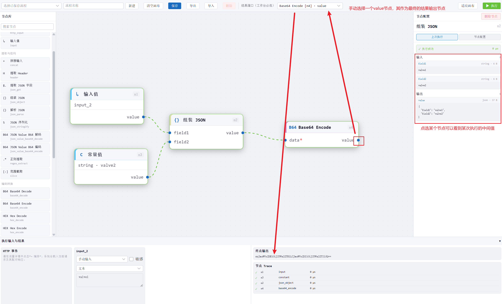

# 3.3 可视化编排

适用版本：TrafficAnalyzer v1.1.10 +

可视化编排（Flow）用于把数据转换拆成节点，通过端口传递数据，可实现非线性流程的数据处理。例如从 JSON 提取字段后解码，或分别读取同一 HTTP 事务的请求头和响应正文，再合并处理结果。节点之间的连线决定数据去哪一步，以及哪些节点必须先执行。

## 建立和试运行流程

1. 打开「可视化编排」。可从「选择已保存流程」载入已有画布，也可以点「新建」。在左侧「节点库」搜索节点名称，拖到画布或双击添加。
2. 从上游节点的输出端口拖线到下游输入端口。点击节点，在右侧「节点配置」填写字段。一个输入端口接一条线，单个输出可以供多个节点使用。点击选中后可删除节点，双击连线可断开。
3. 展开底部「执行输入与结果」，准备输入后点「执行」。例如将一个名为 `sample` 的「输入值」节点连到「Base64 Decode」，把 `aGVsbG8=` 作为文本输入。执行后可在「终点输出」查看对应 `hello` 的字节结果。
4. 出错时从「节点 Trace」找第一个失败节点，查看错误文字，再点该节点的「上次执行」检查端口数据。后续节点显示阻断时，先处理上游错误。

## 选择输入与填写节点字段

| 输入或配置项 | 接收什么 |
| --- | --- |
| **输入值 / 运行时输入名** | 填一个可识别的名称，例如 `sample`。实际值在底部执行区填写，可选择文本或 Hex 字节。Base64 原文作为文本输入，再连解码节点 |
| **常量值 / 固定值** | 供每次运行使用的固定文本、Hex 字节、JSON、数字或布尔值。常量随源流程保存。「执行记录中脱敏」只影响 Trace 中的显示 |
| **本地文件** | 选择绝对路径及类型。原始字节模式保留文件内容，文本模式按 UTF-8 读取，JSON 模式解析结构。每次执行重新读取，单个文件最多 32 MiB。执行区覆盖的路径只用于此次调试 |
| **HTTP 事务** | 读取捕获数据的请求、响应及相应字段。从[HTTP 流量分析](./http-traffic.md)详情点「→ 编排」载入，并在执行区核对事务摘要 |
| **提取 Header** | 输入完整头名，例如 `Content-Type`。可通过「允许缺失」处理某些记录没有该头的情况 |
| **提取 JSON 字段** | 输入字段路径，例如 `items[0]` 或 `envelope.name`。正文还是 JSON 文本时，先连「解析 JSON」 |
| **组装 JSON／拼接输入** | 为字段填写输出名或按顺序组织输入端口。字节组装到 JSON 时必须是有效文本，二进制可先显式转为 Base64 或 Hex |
| **正则提取／范围截取** | 正则填模式和 Flags，捕获组 `0` 表示完整匹配。截取填写含起点、不含终点的范围，`-1` 表示到末尾。文本和字节按各自的单位计算 |

节点库还提供编码转换、密码算法、Java 分析、CyberChef 和 Go 脚本。「CyberChef Operation」可在节点上配置单个算子，支持的参数可绑定端口。「CyberChef Recipe」和「自定义 Go 脚本」从已保存资源中选择。二进制节点报类型错误时，按端口的预期类型显式增加转换节点。

若只想对文本框中的一小段内容调用流程，可以先选中它，再用主窗口右键「选择流程处理…」。要把转换结果用于后续节点，可将转换本身保存并接入图中。

## 保存、复用与共享

1. 在工具栏填写「流程名称」。准备交给解密工作台时，先选「结果端口（工作台必选）」。画布调试可留空，执行时会收集终点输出。
2. 点击「保存」，在确认窗口设置名称、分组和调用位置。以后可通过「调用设置」调整，或在[流程库](./workflow-library.md)管理。已保存 Flow 在工作台的步骤选择器中出现后，按该 Flow 的输入类型送入字段或完整事务。选区快速调用要求一个具名的手动文本或字节输入和明确的结果端口。
3. 需要分享时，画布的「导出」可以导出当前配置及相关资源。导入时先查看预览，确认后载入。常量、本地路径和源资源参数可能随包导出。运行时输入和本地文件内容由接收者另外提供。含外部服务节点的编排在本版暂不支持导入或分享。

可通过「外部服务请求」节点调用[外部服务](./external-services.md)。选择已配置服务，填参数名并逐条连接上游输入，按服务输出模式接收正文字节或 JSON。点击画布「执行」后会列出调用地址，确认后才发送。
