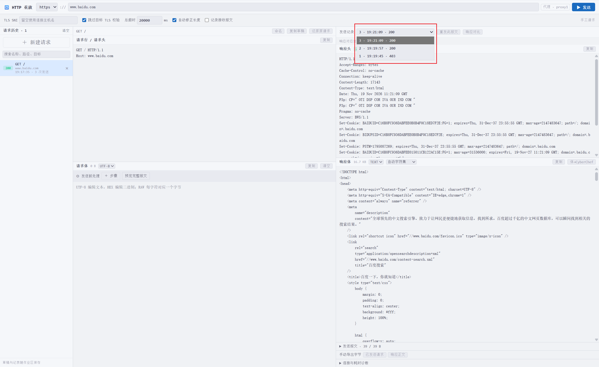

# 3.4 HTTP 重放

适用版本：TrafficAnalyzer v1.1.10

「HTTP 重放」可把已有请求载入独立草稿，查看将发送的报文，并与测试服务的响应进行对照。「发送」会向连接目标发起真实请求。用测试接口核对请求格式时，可以先通过预览检查地址、头部和正文。

## 载入或新建草稿

从[HTTP 流量分析](./http-traffic.md)的请求详情点击「重放」，应用会载入请求行、头部和可用正文。每次载入会新建一个条目。也可从左侧「＋ 新建请求」打开示例草稿，按需编辑请求行、请求头与请求体。请求行和头部以换行分隔。

| 字段 | 填什么或如何使用 |
| --- | --- |
| **协议／连接目标 host:port** | 选择 `http` 或 `https`。目标框填连接主机名或 IP，可附端口，如 `127.0.0.1:8080`。请求路径填在请求行中 |
| **请求行 / 请求头** | 第一行是方法、路径和 HTTP 版本，例如 `GET /health HTTP/1.1`。随后每行是一个头，如 `Host: localhost`。连接目标决定实际连接到哪里，`Host` 是随报文发送的头 |
| **请求体** | UTF-8 接收普通文本，HEX 接收十六进制字节，RAW 将每个字符对应到一个字节。检查当前模式和字节数后再预览 |
| **总超时** | 输入毫秒数，例如 `5000` 表示 5 秒 |
| **自动修正长度** | 自动根据实际请求正文调整长度相关头部。编辑正文或使用发送前处理时可以保持开启 |
| **TLS SNI／跳过目标 TLS 校验** | SNI 是 HTTPS 握手使用的服务名称，留空时使用连接主机名。「跳过目标 TLS 校验」是这次请求的目标证书选项，HTTPS 代理证书由「配置」单独管理 |
| **记录接收报文** | 记录接收到的 HTTP 字节，供回查分块和中间响应。HTTPS 下记录的是解密后的 HTTP 字节，界面会显示是否达到 20 MiB 的记录上限 |

可在左侧按名称、路径和目标搜索草稿。在打开的草稿上可「命名」「复制草稿」或「还原原请求」。请求体里的可选文本也可以选中后右键调用通用文本处理，具体见[第二章](../02-interface-and-menus.md)。

## 预览、发送与查看结果

1. 如果正文要经过已验证的格式转换，在「发送前处理」点击「＋ 步骤」，选择允许在重放中调用的 [CyberChef 配方](./cyberchef.md)。多个步骤按顺序执行。配方支持逆向时，「⇄」可临时反转当前步骤。预览可验证转换后的实际字节。
2. 点击「预览完整报文」，检查请求行、Headers、Body 和自动调整提示。预览会执行配置的处理步骤，到点击「发送此预览」时才会把预览中的报文发送到连接目标。也可用顶部「发送」按当前草稿执行。进行中的请求可以「取消」。
3. 在右侧「发送记录」选择一次运行，查看状态码、耗时、响应头和响应体。每条记录对应发送时使用的请求。要再用该记录的报文，在按钮可用时选择「重发此报文」。需要对照时点「响应对比」。有原始捕获响应时，可将它用作对比基准。
4. 查看响应体时选 TEXT、HEX 或 RAW。TEXT 可指定字符集，有可用解压结果时可以启用「解压查看」。点「体→CyberChef」将响应正文继续交给编辑器处理。也可以在「手动导出字节」保存已发送请求、响应正文或可用的接收报文记录。

「发送报文」和「连接与耗时诊断」适合核对实际发送的字节、路由与超时阶段。走代理时，诊断中的连接对端可能是代理。只看到预览截断时，可用导出项保存应用实际保留的字节。草稿及受支持的发送记录可随[作业区](../01-getting-started.md)保存。

