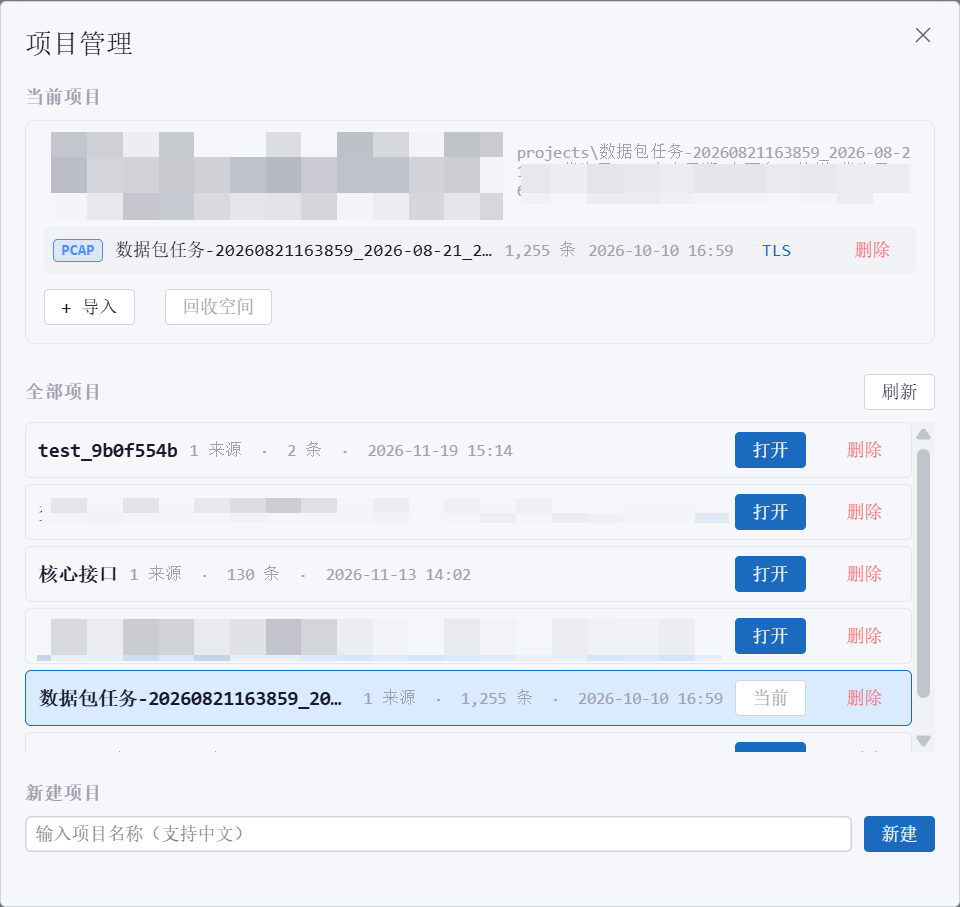
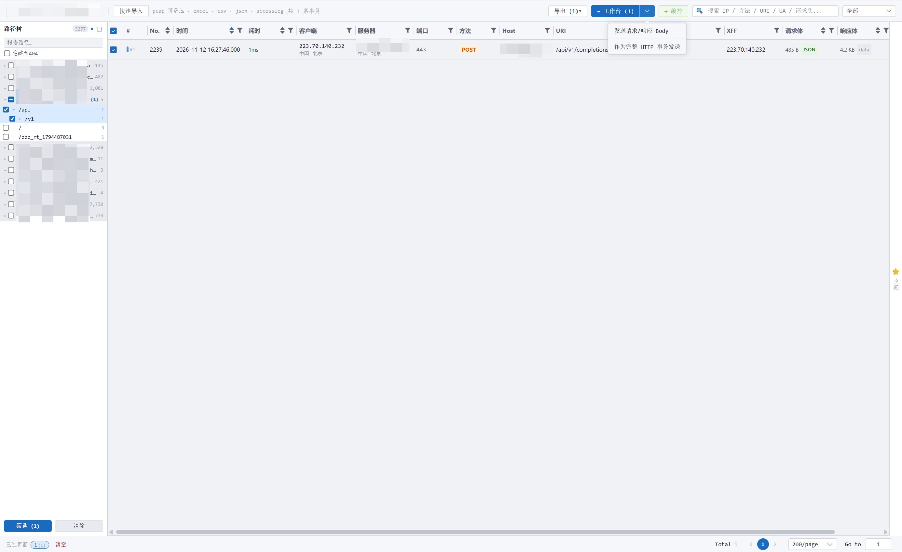
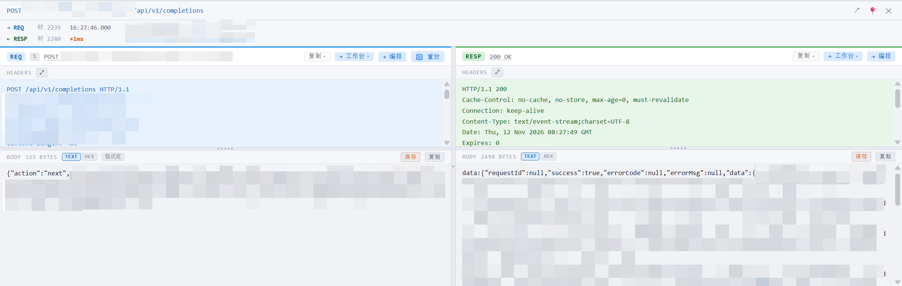
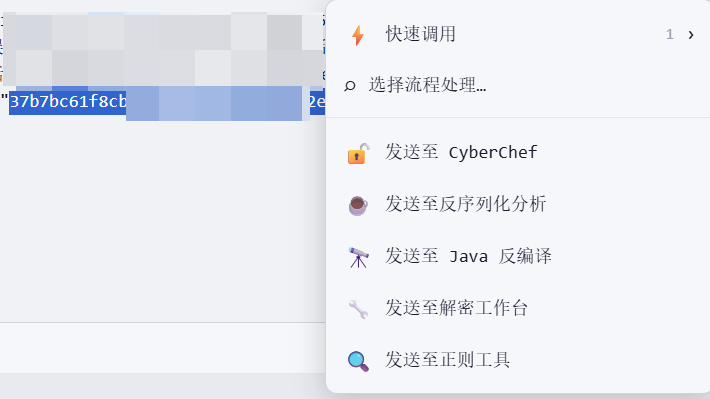
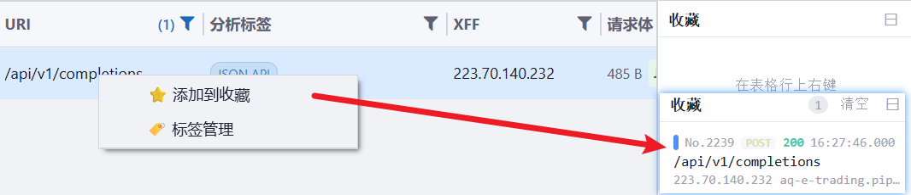

# 3.1 HTTP 流量分析

适用版本：TrafficAnalyzer v1.1.10 +

在左侧选择「HTTP流量分析」。这个页面用于导入和管理数据，从列表筛出需要核查的事务，对照请求与响应，并把选中的内容导出或交给其他模块。首次使用可以先完成[第一章的导入练习](../01-getting-started.md)。

## 打开项目与管理数据来源

点击页面左上角的「项目管理」。已打开项目时，同一位置显示项目名称。

| 操作 | 输入与结果 |
| --- | --- |
| **新建** | 在「新建项目」下填写项目名，例如 `11 月流量排查`，支持中文。新建后可用「+ 导入」向空项目添加来源 |
| **打开** | 在「全部项目」选中已有项目并打开。大型项目会先连接数据库，再加载首屏数据和筛选项 |
| **刷新** | 重新扫描项目目录。手动移入或移出项目数据库后，可用此按钮更新列表 |
| **+ 导入** | 在「当前项目」下向该项目追加文件 |
| **删除来源** | 「当前项目」中每个来源旁的「删除」会从该项目移除对应数据及关联结果。下次需要分析时可以重新导入原文件 |
| **回收空间** | 删除来源后可整理当前项目数据库，回收已释放的空间 |
| **删除项目** | 「全部项目」中的「删除」会永久删除该项目数据库。库文件已不存在的条目显示为「移除记录」 |

一个项目可以包含多个来源。表格 `#` 列旁的色条对应来源，悬停可查看来源文件名。`#` 是界面中的分析序号。`No.` 在 PCAP 来源中对应抓包帧号，来自不同文件的记录可以有相同帧号。核对原始抓包时同时确认来源与帧号。

### 选择导入方式

1. 点击页面顶部「快速导入」并选择文件。支持 PCAP、PCAPNG、CAP、Excel、CSV、JSON、JSONL、NDJSON 和文本访问日志。快速导入可以多选抓包。表格和日志请逐个选择，方便分别确认格式或字段。
2. 出现「导入方式」时，选择「合并到当前项目」继续当前事件，或选择「新建独立项目」。多选抓包时，文件依次解析。选择新建后，其余抓包加入同一新项目。
3. 抓包通常直接解析。出现「发现已有分析项目」时，可选择「使用已有数据」继续前次分析。需要重新解析时再选「重新导入」，并留意旧的导入结果可能被替换。
4. 表格与日志类文件应先核对预览。文件格式无法自动判断时，在「选择导入格式」中指定对应格式。如果 CSV 的预览错列，检查文件实际使用的逗号、制表符、分号或竖线分隔方式。
5. 等待解析、请求响应配对及加载完成。PCAP 解析阶段可以取消，批量导入取消后，已经完成的来源可继续查看。

### 核对表格与 JSON 字段

字段映射的左侧是应用里的**系统字段**，右侧选择原文件的列名或 JSON 字段路径。自动识别用作初选，尤其要核对请求和响应的数据有没有映射反。字段缺失时可以留空。

| 系统字段 | 可用内容 |
| --- | --- |
| **时间戳** | ISO 8601 时间，例如 `2026-11-19T09:30:00+08:00`，或 Unix 时间戳 |
| **来源 IP／目的 IP** | 客户端和服务器的 IP 地址。对应端口字段使用端口号 |
| **X-Forwarded-For** | 原记录中的转发头字段，表格中缩写为 XFF。该值可能包含多跳代理信息 |
| **请求方法／主机名** | 请求动词（如 `POST`）与 Host（如 `lab.example`） |
| **URI 路径／完整 URL** | URI 可填 `/api/message`。完整 URL 可填 `http://lab.example/api/message`，应用会解析其中的主机和路径 |
| **响应状态码** | 数字状态码，例如 `200` 或 `404` |
| **请求头／响应头** | 对应方向的完整头部文本。JSON 对象形式的 Headers 可转换为逐行文本 |
| **请求体／响应体** | 对应方向的正文。JSON 对象或数组也可整体映射为 Body |

例如嵌套 JSON 模型中的请求方法可以映射为 `/request/method`。快速预览是抽样，需要找较少出现的字段时，可以手动填写字段路径或选择「全量扫描字段」。文本访问日志使用「日志格式」与解析预览确认字段，格式选法见[第一章《开始使用》](../01-getting-started.md)。

### 查看 HTTPS 导入状态

有 TLS 待处理时，点击顶部「TLS 待查看」，也可以在「项目管理」中点对应来源的 TLS 状态。应用可以读取原抓包扫描握手及补充密钥。成功恢复的 HTTP 记录会出现在原项目，Host 旁带有「HTTPS」标记。密钥日志、RSA 私钥格式，以及 v1.1.10 支持的 HTTP 版本见[第一章《开始使用》](../01-getting-started.md)。

## 搜索、筛选与批量选择

右上角搜索框接收 IP、方法、URI、Host、UA 或请求头中的文字片段。例如输入 `/api/message` 查找带这段路径的记录。搜索会与已应用的列和路径条件一起生效。旁边的事务类型下拉框可以选择「全部」「仅完整」「无响应」「孤儿响应」或「WebSocket」。

点列标题的筛选图标可按字段细查。

| 列 | 怎么筛 |
| --- | --- |
| **客户端、服务器、端口、方法、Host、XFF、状态、分析标签** | 勾选该列的候选值，再点「确定」。同列多选时匹配其中一项。不同列的条件会叠加 |
| **时间** | 输入起止日期和时间，按本机时区选择。点「重置」可解除该列范围限制 |
| **耗时** | 填最小值或最大值，单位为毫秒（ms）。查看请求至配对响应的时间差 |
| **请求体／响应体** | 填正文大小的最小值或最大值，单位为字节（B） |
| **URI** | 用「＋ 包含」或「－ 排除」添加正则条件，如 `^/api/`。可另选「排除常见静态资源」，隐藏常见 JS、CSS、图片等资源 |

如果已经看到想筛选的值，把鼠标停在支持快捷操作的单元格上，例如方法列的 `POST`。在浮出的菜单中点击「筛选」只保留该值，点击「排除」去掉该值，或点击「复制」取走单元格内容。应用后可以在该列的筛选面板中继续修改条件。带排序箭头的列可点击切换排序。底部可以选择每页数量和跳页。

### 用路径树缩小范围

1. 展开左侧「路径树」。路径先按 Host 分组，再按 URI 路径层级展开。输入「搜索路径…」可以在树中查找分支。
2. 勾选某个路径、分支或整个 Host，再点「筛选 (数量)」应用。数字表示所选路径覆盖的请求数，实际列表还会受已生效的其他条件影响。
3. 「隐藏全404」在树中隐藏所有响应均为 404 的路径。勾选整个 Host 或分支时，范围包含其下暂时隐藏的路径。只想查看搜索结果中的某条路径时，直接勾选那条。
4. 想取消当前路径条件时，先点「清除」撤掉勾选，再点「筛选 (0)」。清除勾选和应用筛选是两个操作。

### 选取多条事务

勾选表格左侧的复选框，即可使用顶部的「导出」「→ 工作台」或「→ 编排」。可翻到其他页继续勾选。底部「已选页面」显示各页的勾选数量，点击页码可返回该页。「清空」会取消全部勾选。改变筛选条件、切换项目或重新载入数据后，应重新确认勾选范围。工具栏「→ 编排」只载入第一条勾选的事务。

## 查看详情与保存原始正文

点击任意事务行，在下方打开详情。左侧 **REQ** 为请求，右侧 **RESP** 为响应。顶部时序栏显示已记录的帧号、时间和端点。遇到「无响应」或「孤儿响应」时，只能查看实际存在的一侧。拖动中间或上下分隔条，可给 Headers、Body 或某一侧留出更多空间。

| 详情控件 | 作用 |
| --- | --- |
| **Headers** | 查看请求头或响应头。可通过旁边的预览入口单独查看长头部 |
| **TEXT／HEX** | 在可读文本与字节的十六进制表示之间切换 |
| **格式化／渲染图片** | 内容可识别时出现。可格式化文本，或预览识别出的图片 |
| **%** | 在请求栏切换 URL 解码显示，便于阅读百分号编码的路径 |
| **复制** | 头部菜单可按项复制，如「复制 URL」「仅复制 Headers」或「复制全部」。Body 旁的按钮复制正文 |
| **保存** | 有可用的原始 Body 时，将该侧正文的原始字节保存为文件。需要保留二进制时使用这里的「保存」 |
| **↗** | 将当前记录打开为独立详情窗口。独立窗口保留打开时的记录，适合切换项目或继续点击其他记录时对照。可用图钉开启「始终置顶」 |

### 在详情中右键处理选中文本

1. 在**主窗口**打开一条记录。在 REQ 或 RESP 的 Headers 或 Body 中，用鼠标拖选要处理的文本，例如第一章样例请求体中的 `aGVsbG8=`。如果当前显示 HEX，而你要处理的是正文里的 Base64 字符串，先切回 TEXT。
2. 在选中文本上右键，按需要选择操作。

   | 菜单项 | 什么时候用 |
   | --- | --- |
   | **快速调用** | 将鼠标移到该项或点击展开，然后点选一个已配置的流程，直接处理选区 |
   | **选择流程处理…** | 打开流程选择器，按名称搜索流程。用上面的样例，可选「内置编解码」中的「Base64 解码」，点击「执行流程」，预览结果应为 `hello` |
   | **发送至…** | 将选中的文本填入 CyberChef、正则或 Java 工具等页面，继续检查或编辑 |

3. 详情内容是只读的。处理结果可以在弹窗中查看或复制。若「快速调用」中缺少常用流程，在「流程库」中打开该流程的「调用设置」，勾选「快速调用」并点「保存设置」。选区和结果动作的通用规则见[第二章《认识界面与菜单》](../02-interface-and-menus.md)。

右键发送的是选中的这段文本。需要保留原始字节，或将响应正文放到工作台响应侧时，使用详情中对应一侧的「→ 工作台」→「发送 Body」。

## 收藏与分析标签

### 收藏与取消收藏

1. 在表格中找到要留存的那一行。先取消已有的文本选区，再在这行的单元格上右键，例如在「方法」列上右键。
2. 点击「添加到收藏」，展开表格右侧的「收藏」面板。点击收藏项即可直接打开详情，无需回到原来的分页。收藏按项目区分。
3. 要移除某条收藏，在原表格行上右键选「取消收藏」，或点击收藏项右侧的「×」。

### 查看标签与处理业务例外

**分析标签**来自威胁检测、流量行为和画像关联。点击标签或「+N」打开「标签管理」，也可在请求所在行右键选择「标签管理」。可查看候选标签、证据和适用的细化规则。画像关联用于提示该 IP 或 URI 的其他上下文，判断单条请求时应结合它自己的内容和命中证据。

如果核对后确认某标签对应正常业务，可以从「标签管理」选中该标签，在「设为业务例外」中选择生效范围。支持仅当前请求、当前客户端 IP、当前 Host/URI、当前 IP + Host/URI，以及项目内全部该标签。在备注框填写原因（可选，最多 200 字），查看预计隐藏的请求条数，再点击「确认设为例外」。业务例外按项目保存，作用于标签展示和筛选，原始分析结果会保留。可在「管理全部例外策略」中停用规则，恢复显示。

> 截图占位 `03-http-tag-evidence.png`。截取「标签管理」，包含标签类别、命中证据、范围选项和影响条数预览。

## 导出事务与抓包

勾选要保存的 HTTP 事务后，打开顶部「导出」下拉菜单，选择格式并指定文件位置。跨页勾选时会使用累计选中的事务。

| 导出格式 | 内容与用途 |
| --- | --- |
| **CSV** | 每条选中事务一行，包含来源、端点、请求/响应字段。Body 使用带 `base64:` 前缀的文本保存，便于保留字节内容 |
| **Excel** | 在 `Transactions` 工作表中对照两侧 Headers 与 Body。正文可按 UTF-8 读取时直接写入，其余以 Base64 保存。超过单元格上限时会标明截断。需要完整正文时可选 CSV 或在详情中保存原始 Body |
| **PCAP** | 生成 `.pcapng`。应用优先从仍可读取、且文件指纹与导入记录一致的原始抓包中提取对应 TCP 流。为了保留可重组的流，同一连接中的其他报文也可能随之导出 |

例如，事务来自 JSON 日志、原始抓包已移动，或抓包内容发生改变时，应用可能提示「无法导出原始 PCAP」。可选择「生成合成 PCAP」，将项目保存的 HTTP 内容重建为用于后续检查的抓包文件。其帧和连接由程序重组生成，**并非原始数据**。

## 与工作台和其他模块联动

发送后如何选择输入字段、配置步骤和执行批次，见[第四章 解密工作台](../04-decryption-workbench.md)。

| 要继续做什么 | 从哪里发送 | 接收的数据 |
| --- | --- | --- |
| 解码某一侧正文或处理头部 | 在详情的 REQ 或 RESP 中点击「→ 工作台」，选择「发送 Body」或「发送 Headers」 | 当前侧的原始正文字节或头部文本 |
| 批量处理多条事务的正文 | 勾选后点击工具栏「→ 工作台」，或在下拉中选「发送请求/响应 Body」 | 各条记录已有的正文分别进入工作台请求侧或响应侧 |
| 在工作台保留配对关系 | 详情选「发送完整 HTTP 事务」，或勾选后选「作为完整 HTTP 事务发送」 | 事务中已取得的两侧数据和关联信息。缺失的一侧保持空缺 |
| 用编排同时提取多个 HTTP 字段 | 点击「→ 编排」 | 从选定事务载入 HTTP 数据，供编排中的 HTTP 输入节点使用 |
| 在重放页面检查请求配置 | 在详情的请求侧点击「重放」 | 把已有请求载入重放编辑区。发送网络请求需在重放页面另行操作 |
| 用 CyberChef、正则或 Java 工具处理文本片段 | 选中文本并使用右键「发送至…」 | 选中的文本。收件标签的选择方式见[第二章《认识界面与菜单》](../02-interface-and-menus.md) |

## 常见问题

- **导入后列表为空。** 先核对项目和来源，再清除搜索、列筛选及路径树条件。还可以把事务类型切回「全部」。抓包中若没有可提取的 HTTP 数据，可到「网络层分析」检查通信情况。有待处理的 TLS 时可检查 HTTPS 解密状态。
- **访问日志能看到状态码，但 Body 为空。** 先核对原始日志是否包含正文，以及该字段是否正确映射。日志通常只记录访问摘要。
- **数据有响应但信息不齐。** 「仅完整」表示已配对请求和响应。正文、头部等字段仍取决于源文件记录的内容。
- **改了路径树勾选但表格没变。** 点击树底部「筛选」应用勾选。表格中的其他筛选条件会继续参与查询。
