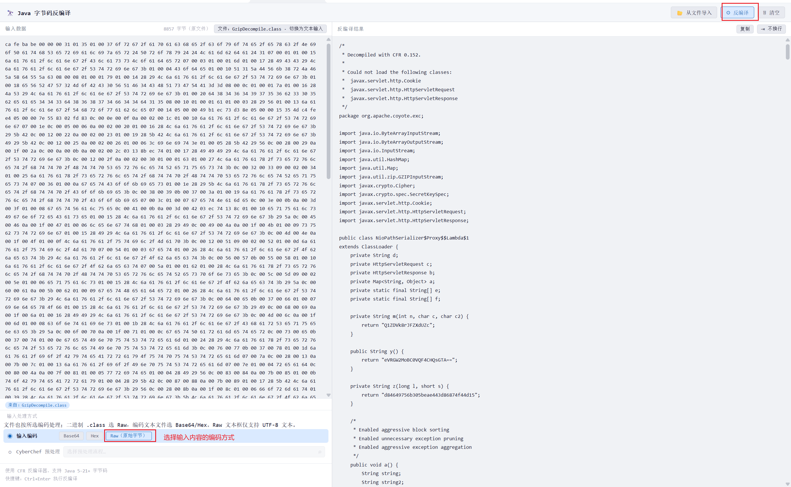

# 3.9 Java 反编译

适用版本：TrafficAnalyzer v1.1.10 +

「Java 反编译」用 CFR 将 `.class` 字节码转换为可阅读的 Java 源码。先从底部状态栏确认 Java 可用。未检测到时，在「配置」的「JDK bin 目录」选择包含 `java.exe` 的目录，并重新检测。

## 准备输入与反编译

1. 判断输入格式。普通 `.class` 以 `CA FE BA BE` 为文件头。若输入是序列化对象流（`AC ED 00 05`），改用[反序列化分析](./java-deserialization.md)。
2. 按数据来源选择「输入处理方式」。

   | 输入 | 选项 |
   | --- | --- |
   | **二进制 .class 文件** | 在「输入编码」选 Raw，再点「从文件导入」。程序使用完整文件字节 |
   | **Hex 或 Base64 文本** | 在输入框粘贴内容，选择对应的输入编码。若编码文本保存在文件中，也可用这个编码导入 |
   | **需要先解码、解压或提取的样本** | 选「CyberChef 预处理」和允许「反编译预处理」的配方。配方最终应输出完整 Class 字节。此方式需要 CyberChef Server |

3. 点击「反编译」或在输入框按 `Ctrl+Enter`。文件导入后会按当前选项尝试反编译。右侧显示源码或错误信息，可复制或切换换行。

手动 Raw 文本框接收 UTF-8 文本。对二进制 Class 使用文件或编码文本输入。预处理在点击「反编译」时自动执行。输出是根据字节码还原的源码，原项目中的注释等信息可能缺失。

## 从其他模块继续分析

在 HTTP 详情等页面选中编码文本后，右键「发送至 Java 反编译」，再核对输入编码。工作台结果区可使用「→ 反编译」发送完整结果字节。可视化编排中的「JAVA 反编译」节点则接收上游 Class 字节并输出源码文本。

若出现 Java 不可用，先检查状态栏与 JDK 路径。如果 Java 正常但报 Class 无效，检查解码后的头部和文件是否完整。

