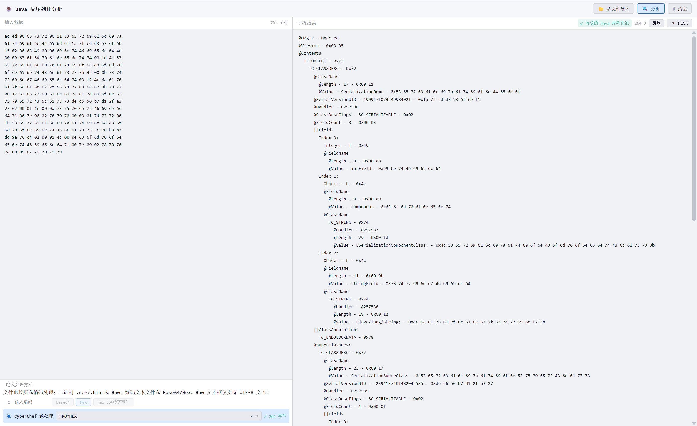

# 3.8 反序列化分析

适用版本：TrafficAnalyzer v1.1.10 +

「反序列化分析」解析标准 Java 序列化流，输出类名、对象和字段等可读结构。常见文件头是 `AC ED 00 05`。解析只读取结构。若样本头是 `CA FE BA BE`，请用 [Java 反编译](./java-decompiler.md)查看类字节码。

## 选择输入处理方式

| 手上的数据 | 操作 |
| --- | --- |
| **Base64 或 Hex 文本** | 在「输入数据」粘贴内容，选择「输入编码」→ Base64 或 Hex。Hex 填字节的十六进制文字表示 |
| **二进制 .ser 或 .bin 文件** | 先把「输入编码」设为 Raw，再点「从文件导入」。Raw 模式可把二进制文件原样交给解析器 |
| **存放 Base64 或 Hex 的文本文件** | 先选择对应的输入编码，再导入文件。预览只是文件的一部分，执行使用完整文件 |
| **需要先剥掉外层编码的内容** | 选择「CyberChef 预处理」及一个配方。点击「分析」后先执行配方，再将输出字节交给解析器。配方需允许用于「反序列化预处理」，且 CyberChef Server 可用 |

Raw 模式的文本框按 UTF-8 接收文本。任意二进制建议用文件导入、Hex/Base64 文本或工作台的发送入口。文件导入后可以点击文件名旁的「切换为文本输入」返回手动输入。

## 分析与核对结果

输入就绪后点击「分析」，或在输入区按 `Ctrl+Enter`。文件导入后会按当前选项尝试分析。右侧「分析结果」显示序列化结构和大小，可切换换行、复制文本。出现无效数据或解析错误时，检查当前编码和供解析的字节头，确认是否还需解码或补全样本。

从其他主窗口页面可选中文本，右键「发送至反序列化分析」，再核对接收后的编码。工作台结果区的「→ 反序列化」保留字节内容。也可以在编排加入「Java 反序列化分析」节点，将上游已解码的原始字节接入节点，直接把可读结构交给后续步骤。

