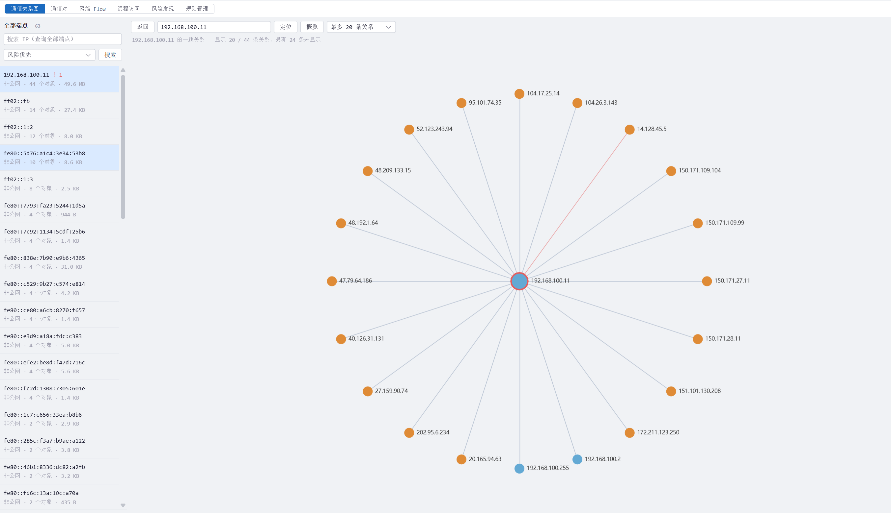
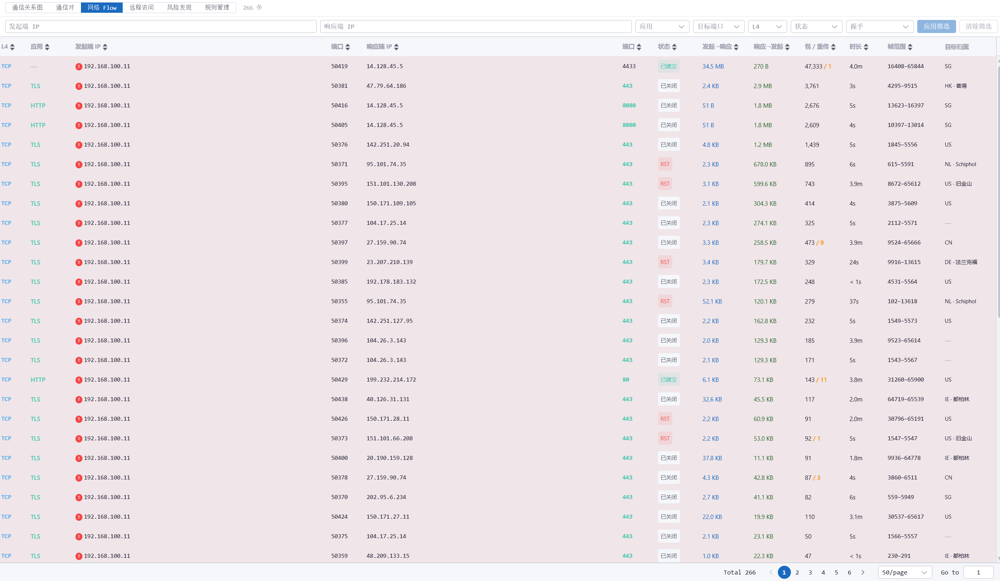

# 3.2 网络层分析

适用版本：TrafficAnalyzer v1.1.10

「网络层分析」从原始抓包提取 IPv4／IPv6 的 TCP、UDP 通信。适合确认某个 IP 与谁通信、使用哪些端口，以及流量在什么时候出现。先在[HTTP 流量分析](./http-traffic.md)打开含 PCAP 来源的项目，保留原文件并确认 tshark 可用。

## 运行分析

1. 点击左侧「网络层分析」，选择「运行网络层分析」。已有结果时可点「重新分析」。
2. 等待提取流量、汇总和风险检测。可在工具栏点「停止」。多来源项目中，已完成的来源仍可查看。正在处理的来源若取消或失败，会保留该来源上一次完成的结果。
3. 完成后从「通信关系图」检查端点，从「通信对」「网络 Flow」「远程访问」或「风险发现」查看明细。

只有表格或访问日志的项目缺少生成网络 Flow 所需的原始数据。即使 HTTP 表格为空，PCAP 仍可能包含可分析的 TCP／UDP 流量。

## 从通信关系图定位 IP

1. 左侧「搜索 IP（查询全部端点）」接收 IP 查询词，按 Enter 或点击「搜索」。可按风险、通信对象数、流量或最近活动排序，并翻页查看完整端点列表。
2. 点击端点或图中主机，查看它与直接对端的**一跳关系**。也可在图上方输入完整 IP 后点「定位」。用「返回」回到上一个中心，或点「概览」查看项目中优先展示的关系。
3. 点击两台主机之间的连线，打开「通信详情」。同一对 IP 的不同端口、协议和方向汇总为一条线。「查看全部 Flow / 协议与端口」打开该 IP 对的双向明细，「以对端为中心」切换到另一端查看。

图上方的关系数量限制只影响图中显示的连线。节点的公网／非公网颜色表示地址类型。红框提示该主机有告警，红线表示这一对 IP 有直接关联告警。非公网地址仍需结合实际资产范围核对归属。

## 查看通信对与网络 Flow

| 页面 | 怎么用 |
| --- | --- |
| **通信对** | 在「过滤 IP」输入相关地址来缩小范围。每行汇总 A、B 两端的双向抓包字节、包数和活动时间。点表格行可切换查看「应用载荷」「数据包」「新建 Flow」时间线，图中注明统计的时间桶粒度 |
| **网络 Flow** | 查看单条流的发起、响应端点和端口、协议、握手、载荷、包数、重传和帧范围。可点击表格中的应用、端口或地址快速筛选，也可在上方设置条件 |
| **远程访问** | 汇总 SSH／RDP 连接。按 IP 查找，结合方向、尝试数、完成握手数、RST、双向载荷和末次活动核查。「关联告警」来自风险检测结果 |

「网络 Flow」的「发起端 IP」「响应端 IP」接收各方向的 IP。通过图中的通信详情进入时，会直接带入双向通信对条件。应用、目标端口、L4、状态和握手从下拉框选择，再点「应用筛选」。「清除筛选」可回到完整列表。可排序列在结果分页前排序。

- **L4** 是传输层协议，例如 TCP 或 UDP。「应用」是根据协议解析或端口得到的线索。遇到仅凭端口推测的结果，可结合行内协议证据核对。
- **未观察完整握手** 表示抓包中缺少握手证据，例如捕获从连接中途开始。判断连接失败时还要看 SYN、RST 等可见信息。
- **抓包字节**与**载荷字节**是不同的统计口径。载荷统计包含可见的重传，适合比较方向和时间趋势。

## 核查风险与调整规则

在「风险发现」查看类型、级别、来源、目标、数量及详情。端口扫描、主机扫探、异常外发和周期性通信等条目是排查线索。可以用时间、通信对和 Flow 帧范围回看原包，结合业务角色判断。

在「规则管理」通过「启用」开关调整网络检测规则。设置影响后续的网络层分析，修改后点「重新分析」更新当前结果。需要检查 HTTP 正文、请求头或 HTTP 告警时，可记下 IP 和时间段，再回到[HTTP 流量分析](./http-traffic.md)筛选，或查看[威胁检测](./threat-detection.md)。
