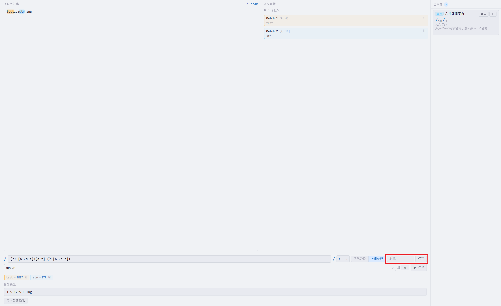

# 3.10 正则工具

适用版本：TrafficAnalyzer v1.1.10

「正则工具」用于验证匹配、高亮捕获组，或对匹配的片段执行替换和配方处理。从 HTTP 详情等页选中文本后右键「发送至正则工具」，可以把文本直接填到「测试字符串」。

## 匹配与替换

1. 在「测试字符串」输入要检查的全文，例如 `name=alice`。在斜杠之间的正则输入框填表达式本身，例如 `name=(\w+)`。
2. 点右侧 Flags 下拉选择选项。新建默认有 `g`，用于查找所有匹配。可选 `i` 忽略大小写、`m` 让首尾锚点按行匹配，或 `s` 让点号跨行。
3. 右侧「匹配详情」显示匹配位置、完整命中和捕获组。可悬停查看对应高亮，也可单独复制结果。
4. 需要替换时，选「匹配替换」，在「替换」框填文本，例如 `user=$1`。这里的 `$1` 引用第一组，预览会显示 `user=alice`。留空时可以用作匹配与高亮工具。

## 用配方处理捕获组

1. 选「分组处理」，从「选择处理流程…」中选择一个允许用于正则分组处理的 [CyberChef 配方](./cyberchef.md)。
2. 在「组」填捕获组编号。`0` 表示整个匹配，`1` 表示第一组。点击「运行」前，核对右侧每条匹配都有需要的组，避免把完整匹配交给配方。此功能调用 CyberChef Server。
3. 查看每项处理前后的值，以及回填到原位置的「最终输出」。如果单项显示错误，先检查该捕获组的内容和配方所需的输入类型。可点击「复制最终输出」保留完整文本。

## 保存与复用

填写「名称」后点「保存」。保存窗口可选名称、分组和调用位置。右侧「已保存」可「载入」已有配置，或通过「调用设置」到[流程库](./workflow-library.md)调整。

设置了替换内容的正则可当作替换步骤，关联了配方的正则可当作分组处理步骤，在工作台或快速调用中使用。只有匹配条件的模板仍能从已保存列表打开，也可以在工作台的内联正则步骤里当作素材。需要单独执行时再补全替换内容或配方。
