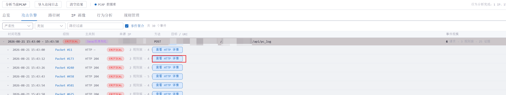
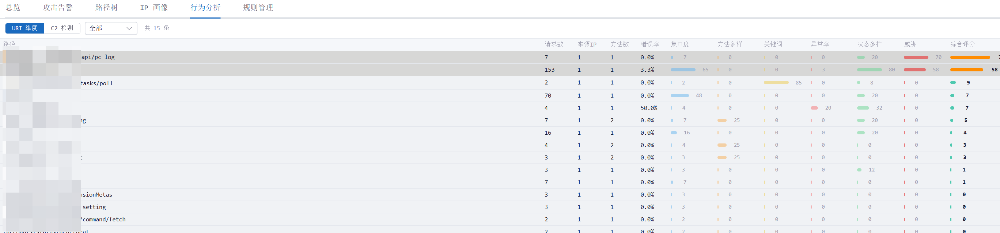

# 3.5 威胁检测

适用版本：TrafficAnalyzer v1.1.10 +

「威胁检测」对已有 HTTP 数据进行规则检测和行为统计，适合从告警找回原始证据，或从 IP 与路径的异常模式确定排查顺序。

## 准备数据并运行

1. 在[HTTP 流量分析](./http-traffic.md)打开已有项目，切到「威胁检测」，点「分析当前PCAP」，等待规则扫描和行为计算完成。界面会显示当前分析来源和进度。
2. 只有文本访问日志时，也可以在本页点「导入访问日志」，选择 Apache／Nginx 常见格式的日志文件直接分析。需要配置格式、预览字段或保留项目来源时，先从 HTTP 流量分析的导入入口处理。
3. 从「总览」查看请求量、状态分布、时间变化以及常见来源与路径。要检查某条命中证据，进入「攻击告警」。

「清空结果」用于清理检测和行为展示结果。需要更新结果时可重新分析。操作前先确认当前页面显示的项目或日志来源。

## 从告警回查 HTTP 证据

1. 在「攻击告警」按**严重性**、**类别**缩小范围。「路径过滤」填要关注的 URI 片段，例如 `/api/`。勾选「事件聚合」后，普通告警可按来源、方法和路径汇总。扫描活动按来源、目标和时间窗口归并。
2. 点事件行展开请求列表。事件规模分别统计涉及的请求、规则族与证据量。再点请求行，查看规则 ID、规则名称和命中详情。
3. 有「查看 HTTP 详情」按钮时，点击打开对应报文，对照请求和响应。直接分析的纯日志可能只提供日志行及其字段。可按时间、IP 和 URI 去相关项目进一步核查。

规则命中指出哪项证据符合检测条件。「响应佐证」或「已确认」是应用给出的证据标签，研判时仍应查看请求内容、响应和同一时段的其他记录。重点报文可在 HTTP 列表右键「添加到收藏」，在详情用「→ 工作台」发送原始 Body 或完整事务，或选中文本右键交给专项工具。

## 按路径和行为查看结果

| 页签 | 可查看的数据 |
| --- | --- |
| **路径树** | 按 Host 与 URI 路径层级查找访问量、规则命中与风险分布 |
| **IP 画像** | 对照请求量、持续时间、频率、错误率、URI 数，以及侦察、高频、异常率、写操作几个维度的评分。「!」提示某个单项维度突出 |
| **行为分析 → URI 维度** | 查看路径的请求量、来源数量、方法分布与异常评分。可用于发现某一路径的集中访问 |
| **行为分析 → C2 检测** | 查看同一来源 IP 与目标路径的请求次数、平均间隔、变异系数 CV 和信标评分。CV 较小表示间隔更稳定，正常轮询也可能有相似表现 |

IP 画像和行为分析的分数下拉用于过滤结果，例如选择「≥ 60」只看达到该分数的记录。这里的分数用于确定排查优先级。可先记录 IP、路径和时间，再回流量表查看详情。想核查同一 IP 上的其他非 HTTP 通信，可转到[网络层分析](./network-analysis.md)。

## 查看规则与处理误报

在「规则管理」的搜索框填规则名或 ID，可按「类别」「来源」筛选。来源包括内置、CRS、YAML 和自定义。查看规则级别和描述后，可用行首「启用」开关调整后续检测，再对当前数据重新分析。

如果某条规则仍有检测价值，只是在特定业务条件下重复提示，可在 HTTP 流量分析的「分析标签」中核对证据，并按请求、IP 或 Host／URI 等范围设为业务例外。该设置管理项目里的标签展示和标签筛选。详细步骤见[HTTP 流量分析](./http-traffic.md)。

