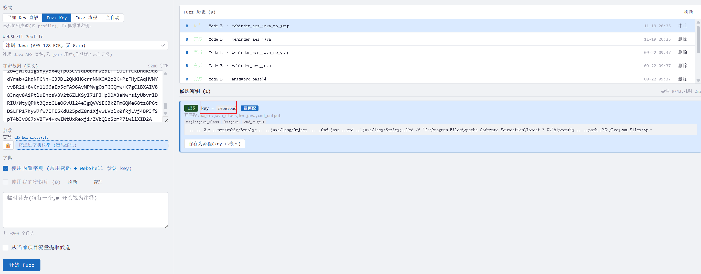

# 3.11 WebShell Fuzz

适用版本：TrafficAnalyzer v1.1.10 +

「WebShell Fuzz」用于分析已捕获的疑似 WebShell 通信正文。工具在现有样本上验证解码和解密候选。先在[HTTP 流量分析](./http-traffic.md)的 REQ 或 RESP 中定位相关 Body，核对来源和通信方向，再把相应的加密内容复制到「加密数据」。**该功能后续会进一步优化**

## 按已有线索选择模式

| 模式 | 什么时候用 | 需要准备什么 |
| --- | --- | --- |
| **已知 Key 直解** | 已知模板以及该样本使用的参数 | 选择 WebShell Profile，填写模板要求的已知密码、密钥或其他参数 |
| **Fuzz Key** | 已知模板，需要在一组已有候选值中核对匹配 | 选择模板与「Fuzz 的参数」，填写其他已知值，再指定候选来源 |
| **Fuzz 流程** | 需要核对样本的处理顺序，已知 Key 或只检查无密钥转换 | 提供样本及已知的可选参数。「已知 Key / 密码」留空时只搜索无密钥流程 |
| **全自动** | 样本的处理顺序与参数都不明确 | 指定样本和候选来源，完成后结合多份样本核对候选 |

**Profile** 是一组解密模板，定义数据经过哪些操作、每个参数应填什么。顶部「已支持 … 种解密类型」可以展开查看覆盖范围。模板参数带模式切换时，密码模式接收用于派生的密码，密钥模式接收最终密钥，具体表示按字段提示填写。查看或导入已有模板时，点击「管理 WebShell 模板」进入[流程库](./workflow-library.md)。

在提供额外样本的模式中，可点「+ 添加样本」，填入同一种通信方向和格式的其他记录，用于交叉验证。页面上的「IV (Hex, CBC)」接收已知 IV 的十六进制表示，「语言提示」用于辅助识别输出，「搜索深度」限制候选流程的步数。

字典来源包括内置字典、用户密钥库和临时补充。临时补充接收每行一项的文本，以 `#` 开头的行用作注释。「管理」可打开密钥库，条目可标为自动判断、密码或原始密钥。「从当前项目流量提取候选」只从当前项目的已导入记录收集线索。锚点包 ID 对应项目中的 Packet ID，用于限定相关记录，旁边的数量字段限制检查范围。

## 运行、核对并复用结果

1. 核对模板和输入后点击「解密」或「开始 Fuzz」。Fuzz 任务可在「Fuzz 历史」查看进度，切换页面后可回来继续看。运行中可点「中止」，已结束的任务可从历史移除。
2. 选中候选，查看评分理由、明文预览和处理步骤。若设置了多份样本，可比较每份样本的评分和解出的结构。短样本可能偶然命中，结合已知字段、多份记录和上下文核对后再使用候选。
3. 对已验证的候选点「保存为流程」，在保存窗口填一个便于识别的名称，选择工作台的调用位置。某些保存方式会把参数或密钥保存在配方中，导出或共享前检查配方内容及名称。
4. 回到 HTTP 详情，通过对应一侧的「→ 工作台」发送原始 Body，在工作台选择已保存的配方继续检查相关数据。想先看算子和参数，可在 [CyberChef](./cyberchef.md)载入配方，用一条样本验证。

没有合适候选时，先确认正文未截断、方向与模板一致，并核对数据是否带有需要先处理的外层格式。

