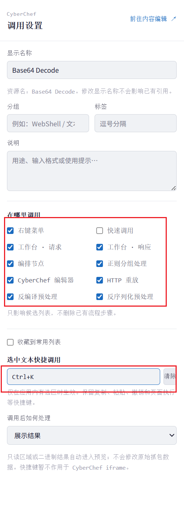
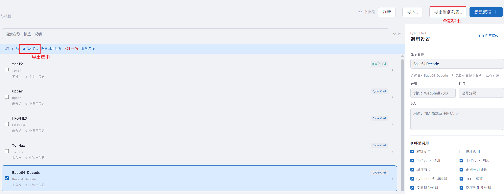

# 3.7 流程库

适用版本：TrafficAnalyzer v1.1.10

「流程库」用于查找已保存的配方、Flow、Go 脚本、正则和辅助资源，也决定哪些流程能在工作台、右键菜单及其他模块中被选用。

## 查找资源与修改调用设置

1. 在左侧选类型、分组或收藏，在搜索框填写名称、标签或说明。点选一项后，右侧显示「调用设置」或「资源设置」。
2. 在「显示名称」写容易辨认的名称。「分组」控制分组展示，「标签」可用逗号分隔，「说明」适合注明用途、输入格式和必要的参数。界面名称变更后，源资源仍可通过原资源名引用。
3. 在「在哪里调用」勾选所需位置。例如，把一个配方放进「工作台 · 请求」或 Java 预处理入口。不同资源类型支持的位置不同。取消勾选会影响在该处新增选择，已有步骤的引用会保留。
4. 点击「保存设置」。要统一调整多个资源，可勾选列表中的行，再点「设置调用位置」。批量操作会覆盖所选项的调用位置。

「前往内容编辑」打开脚本、配方、正则或编排对应的编辑器。顶部「新建流程 ＋」可以从这里进入新建。Go 函数库和 WebShell 模板用于资源管理与引用，可分别提供脚本函数和模板定义。模板可以通过「查看 YAML / 导入副本」查看。

## 在需要的位置快速调用

- **右键菜单**。勾选后，应用内选中文本 → 右键「选择流程处理…」可以查找该流程。
- **快速调用**。勾选后，符合条件的流程还会出现在右键的「快速调用」子菜单。该设置会一并启用「右键菜单」。收藏用于常用列表筛选。
- **选中文本快捷调用**。点击录入框后按组合键，选择「展示结果」「替换选区（可编辑区域）」或「复制结果」，再保存。调用时先选中文本。替换不适用时可查看预览。更多交互见[第二章](../02-interface-and-menus.md)。

## 导入、导出和删除资源

1. **导出。** 使用单项「导出…」、勾选后的「导出所选…」或顶部「导出当前列表…」。导出包包含源内容及可打包的依赖，如 Flow 引用的配方和脚本、脚本引用的函数库，或正则关联的配方。可复制包内容或保存文件。本机快捷键、调用偏好和运行时输入不在包内。分享前可在导出预览里检查常量、源代码或参数默认值。
2. **导入。** 点「导入…」，选择文件或粘贴资源 JSON／模板 YAML，然后点「预览导入」。支持当前资源包、旧 Flow 包、配方 JSON 和 WebShell YAML。确认预览里每项会新增、复用还是另存后，再点「确认导入」。
3. **重名。** 同名同内容会复用。同名不同内容会另存，包内引用随导入名称更新。旧包缺少模板时会列出缺项，必要时另行导入。Go 源码在导入时只保存。
4. **删除。** 可使用单项「删除流程」或勾选后「批量删除」。删除会移除对应源内容和设置，使用它的已有步骤需要另行更换。内置编解码可通过调用位置来隐藏。仍有配方引用的 WebShell 模板需先处理引用。

